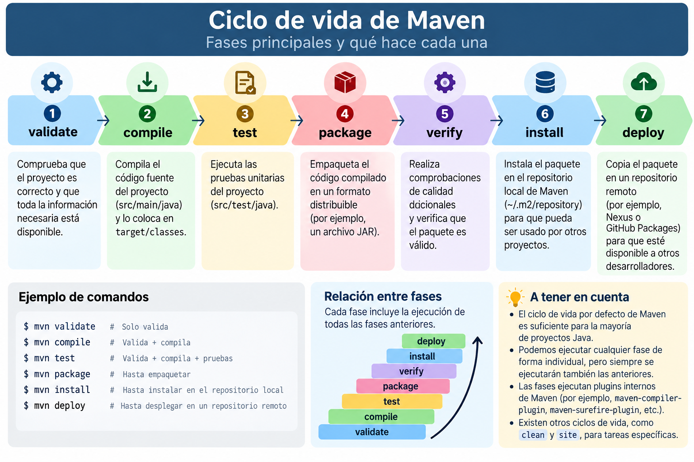

# Ciclo de vida de Maven

## 1. ¿Qué es el ciclo de vida de Maven?

Maven organiza el proceso de construcción de una aplicación Java mediante un conjunto de **fases** que se ejecutan siguiendo un orden establecido.

Este proceso se conoce como **ciclo de vida de construcción** (*build lifecycle*).

Gracias a este mecanismo, podemos automatizar tareas habituales del desarrollo de software:

- Validar la estructura y configuración del proyecto.
- Compilar el código fuente Java.
- Ejecutar las pruebas unitarias.
- Generar un archivo JAR.
- Instalar el artefacto en el repositorio local.
- Publicar el artefacto en un repositorio remoto.

En lugar de realizar manualmente cada operación, Maven permite ejecutar estas tareas mediante comandos desde la terminal o desde un entorno de desarrollo.

!!! info "Idea importante"
    Maven no es un compilador Java. Es una herramienta que coordina y automatiza el proceso de construcción de un proyecto mediante fases y plugins.

## 2. Fases principales del ciclo de vida

Maven dispone de tres ciclos de vida integrados:

- **default:** gestiona la construcción, pruebas, empaquetado e instalación o distribución del proyecto.
- **clean:** elimina los archivos generados en construcciones anteriores.
- **site:** genera documentación del proyecto.

El ciclo de vida `default` es el que utilizaremos principalmente en nuestros proyectos Java.

Aunque incluye más fases, las más habituales son:

| Fase | Función |
|---|---|
| `validate` | Comprueba que el proyecto tiene una configuración válida. |
| `compile` | Compila el código fuente de la aplicación. |
| `test` | Ejecuta las pruebas unitarias. |
| `package` | Genera el artefacto distribuible, normalmente un JAR. |
| `verify` | Ejecuta las comprobaciones necesarias para verificar el paquete. |
| `install` | Instala el artefacto en el repositorio local. |
| `deploy` | Publica el artefacto en un repositorio remoto. |

### Esquema del ciclo de vida

La siguiente imagen muestra la secuencia de las principales fases del ciclo de vida `default`.



*Figura. Fases principales del ciclo de vida de Maven.*

## 3. ¿Cómo funcionan las fases?

Las fases de Maven se ejecutan siguiendo un orden predefinido.

**Cuando solicitamos una fase, Maven ejecuta también todas las fases anteriores de ese mismo ciclo de vida.**

Por ejemplo, al ejecutar:

```bash
mvn package
```

Maven recorre las fases del ciclo de vida `default` hasta llegar a `package`.

Entre las operaciones que normalmente realiza se encuentran:

1. Validar la configuración del proyecto.
2. Procesar los recursos necesarios.
3. Compilar el código fuente Java.
4. Compilar las clases de prueba.
5. Ejecutar las pruebas unitarias.
6. Empaquetar la aplicación en un archivo JAR.

!!! example "Ejemplo"
    Si ejecutamos `mvn package`, no necesitamos ejecutar previamente `mvn compile` ni `mvn test`.

    Maven se encarga de realizar las operaciones correspondientes a las fases anteriores.

!!! warning "Importante"
    Las fases y los plugins no son lo mismo.

    Una **fase** representa una etapa del ciclo de vida. Un **plugin** contiene objetivos (*goals*) que realizan tareas concretas.

    Por ejemplo, la fase `compile` utiliza normalmente un objetivo del plugin `maven-compiler-plugin` para compilar las clases Java.

    Las tareas concretas dependen del tipo de proyecto y de su configuración.

## 4. Descripción de las principales fases

### 4.1. validate

Comprueba que el proyecto dispone de la información necesaria para comenzar su construcción.

```bash
mvn validate
```

En esta fase se valida la configuración básica del proyecto.

### 4.2. compile

Compila el código fuente Java que se encuentra habitualmente en:

```text
src/main/java/
```

Comando:

```bash
mvn compile
```

Las clases compiladas se generan normalmente en:

```text
target/classes/
```

!!! example "Ejemplo"
    Si nuestro proyecto contiene la clase `Alumno.java`, Maven genera su correspondiente archivo `Alumno.class` al compilar correctamente.

### 4.3. test

Ejecuta las pruebas unitarias del proyecto.

```bash
mvn test
```

Las pruebas suelen encontrarse en:

```text
src/test/java/
```

Maven utiliza habitualmente el plugin `maven-surefire-plugin` para ejecutar las pruebas configuradas.

!!! info "Pruebas unitarias"
    En un proyecto Java podemos utilizar JUnit para comprobar automáticamente el funcionamiento de métodos y clases.

    Para ello, es necesario incorporar las dependencias y configuraciones correspondientes al proyecto.

### 4.4. package

Genera el artefacto distribuible de la aplicación.

```bash
mvn package
```

Si el proyecto está configurado para generar un JAR, el archivo aparecerá normalmente dentro del directorio:

```text
target/
```

Por ejemplo:

```text
target/gestion-alumnos-1.0-SNAPSHOT.jar
```

!!! tip "¿Qué es un artefacto?"
    Un artefacto es el resultado de construir un proyecto, como un archivo JAR o WAR.

    Maven lo identifica mediante coordenadas como `groupId`, `artifactId` y `version`.

### 4.5. verify

Realiza comprobaciones adicionales para verificar que el artefacto cumple los criterios de calidad establecidos.

```bash
mvn verify
```

Las comprobaciones concretas dependen de los plugins configurados en el proyecto.

Esta fase resulta útil cuando incorporamos pruebas de integración u otras verificaciones automáticas.

### 4.6. install

Instala el artefacto generado en el repositorio local de Maven.

```bash
mvn install
```

El repositorio local se encuentra habitualmente en:

```text
C:\Users\usuario\.m2\repository
```

En Linux:

```text
~/.m2/repository
```

De esta manera, otros proyectos Maven del mismo equipo pueden utilizar el artefacto como dependencia.

!!! example "Ejemplo"
    Supongamos que hemos desarrollado una biblioteca Java llamada `componente-ficheros`.

    Si ejecutamos `mvn install`, Maven instala su JAR en el repositorio local.

    Posteriormente, otra aplicación Java podrá declarar ese componente como dependencia en su `pom.xml`.

### 4.7. deploy

Publica el artefacto en un repositorio remoto.

```bash
mvn deploy
```

Esto permite que otros desarrolladores o proyectos puedan acceder a la biblioteca publicada.

Para utilizar esta fase es necesario configurar el repositorio remoto y, cuando corresponda, las credenciales de acceso.

!!! note "En nuestro módulo"
    Trabajaremos principalmente con las fases `compile`, `test`, `package` e `install`.

    La publicación en repositorios remotos se presenta como una posibilidad para distribuir componentes reutilizables.

## 5. Comandos habituales

Los comandos Maven se ejecutan desde la carpeta raíz del proyecto, donde se encuentra el archivo `pom.xml`.

| Comando | Resultado |
|---|---|
| `mvn validate` | Valida el proyecto. |
| `mvn compile` | Compila las clases Java. |
| `mvn test` | Ejecuta las pruebas unitarias. |
| `mvn package` | Genera el artefacto. |
| `mvn verify` | Verifica el proyecto y su artefacto. |
| `mvn install` | Instala el artefacto localmente. |
| `mvn deploy` | Publica el artefacto remotamente. |
| `mvn clean` | Elimina los archivos generados por construcciones anteriores. |
| `mvn clean package` | Limpia el proyecto y genera un nuevo paquete. |

### ¿Qué significa `mvn clean package`?

Es uno de los comandos más utilizados durante el desarrollo.

```bash
mvn clean package
```

Ejecuta dos operaciones:

1. `clean`: elimina los archivos generados por construcciones anteriores, normalmente el directorio `target`.
2. `package`: recorre las fases necesarias del ciclo `default` hasta generar el nuevo artefacto.

!!! tip "Buena práctica"
    Cuando necesitemos generar una versión limpia de nuestro proyecto, podemos utilizar `mvn clean package`.

    De esta forma evitamos conservar archivos de compilaciones anteriores.

## 6. Ejemplo práctico: construir un proyecto Java

Supongamos que tenemos un proyecto Maven llamado `gestion-alumnos`.

Su estructura básica es:

```text
gestion-alumnos/
├── pom.xml
└── src/
    ├── main/
    │   └── java/
    │       └── es/
    │           └── ejemplo/
    │               └── App.java
    └── test/
        └── java/
```

### Paso 1. Configurar el proyecto

En el archivo `pom.xml` indicamos las coordenadas del proyecto y la versión de Java que utilizaremos.

```xml
<project xmlns="http://maven.apache.org/POM/4.0.0"
         xmlns:xsi="http://www.w3.org/2001/XMLSchema-instance"
         xsi:schemaLocation="http://maven.apache.org/POM/4.0.0
         https://maven.apache.org/xsd/maven-4.0.0.xsd">

    <modelVersion>4.0.0</modelVersion>

    <groupId>es.ejemplo</groupId>
    <artifactId>gestion-alumnos</artifactId>
    <version>1.0-SNAPSHOT</version>

    <properties>
        <maven.compiler.release>21</maven.compiler.release>
        <project.build.sourceEncoding>UTF-8</project.build.sourceEncoding>
    </properties>

</project>
```

### Paso 2. Crear una clase Java

Archivo `src/main/java/es/ejemplo/App.java`:

```java
package es.ejemplo;

public class App {

    public static void main(String[] args) {
        System.out.println("Proyecto Maven funcionando");
    }
}
```

### Paso 3. Compilar el proyecto

Desde la terminal, situados en la carpeta `gestion-alumnos`, ejecutamos:

```bash
mvn compile
```

Maven compilará el archivo `App.java` y generará:

```text
target/classes/es/ejemplo/App.class
```

### Paso 4. Generar el JAR

Ejecutamos:

```bash
mvn package
```

Maven generará el archivo:

```text
target/gestion-alumnos-1.0-SNAPSHOT.jar
```

!!! warning "JAR y ejecución"
    El JAR generado por esta configuración básica no incluye necesariamente un atributo `Main-Class` en su manifiesto.

    Por tanto, no debemos asumir que podremos ejecutarlo directamente con `java -jar`.

    Para crear un JAR ejecutable es necesario configurar adecuadamente el empaquetado. Este procedimiento se explica en el apartado **Empaquetado JAR** del anexo.

### Paso 5. Instalar el componente

Ejecutamos:

```bash
mvn install
```

El artefacto se instalará en el repositorio local de Maven, dentro de una estructura basada en sus coordenadas:

```text
.m2/repository/
└── es/
    └── ejemplo/
        └── gestion-alumnos/
            └── 1.0-SNAPSHOT/
                └── gestion-alumnos-1.0-SNAPSHOT.jar
```

## 7. Relación con el desarrollo de componentes

En la UT3 desarrollaremos componentes Java reutilizables para acceder a datos.

Maven nos permitirá:

- Organizar el código fuente del componente.
- Gestionar sus dependencias externas.
- Compilar las clases Java.
- Ejecutar pruebas automatizadas.
- Generar un archivo JAR.
- Instalarlo en el repositorio local para reutilizarlo desde otras aplicaciones.

Por ejemplo, podemos desarrollar una biblioteca denominada `componente-jdbc` que encapsule operaciones de acceso a bases de datos.

Una vez generado e instalado su JAR mediante Maven, otros proyectos podrán incorporarlo como dependencia.

Esta forma de trabajar favorece la **modularidad, reutilización y mantenimiento del software**.

## 8. Actividad de comprobación

Responde a las siguientes preguntas:

1. ¿Qué entendemos por ciclo de vida de Maven?
2. ¿Qué diferencia existe entre una fase y un plugin?
3. ¿Qué ocurre cuando ejecutamos `mvn package`?
4. ¿En qué directorio se generan normalmente las clases compiladas?
5. ¿Qué diferencia existe entre `package` e `install`?
6. ¿Para qué sirve el repositorio local de Maven?
7. ¿Qué hace el comando `mvn clean package`?
8. ¿Por qué puede resultar útil Maven cuando desarrollamos componentes Java reutilizables?

??? success "Ver soluciones orientativas"

    1. Es el conjunto ordenado de fases que organiza la construcción de un proyecto.
    2. Una fase es una etapa del ciclo de vida; un plugin implementa tareas concretas mediante objetivos.
    3. Maven ejecuta las fases anteriores necesarias hasta empaquetar el proyecto.
    4. Normalmente en `target/classes`.
    5. `package` genera el artefacto; `install` lo incorpora al repositorio local.
    6. Permite almacenar artefactos y dependencias para utilizarlos desde proyectos del equipo.
    7. Limpia los archivos generados anteriormente y construye un nuevo paquete.
    8. Porque automatiza su compilación, pruebas, empaquetado e instalación para reutilizarlos en otros proyectos.

---

**Continúa con:** [Comandos esenciales de Maven](09-comandos.md).
