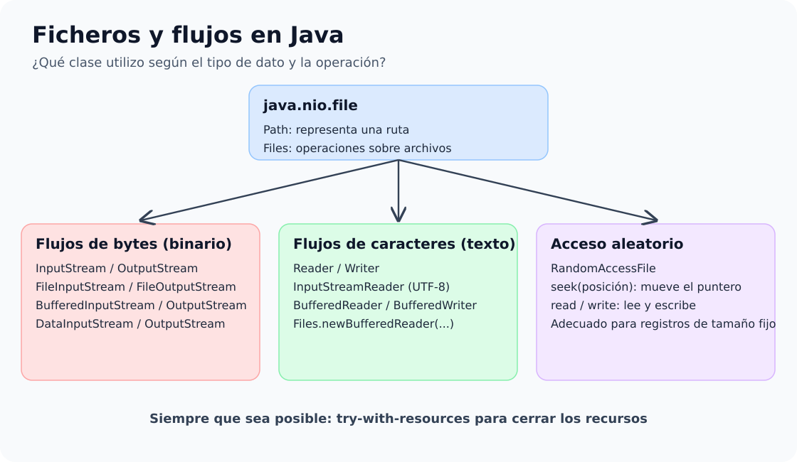

# 1. Ficheros, flujos y excepciones

Java proporciona distintas clases para trabajar con ficheros y directorios. La elección depende de qué información queremos almacenar y de cómo necesitamos acceder a ella.

## Mapa conceptual: ficheros y flujos en Java

## Qué vamos a estudiar

- Gestión de ficheros y directorios con `File`.
- Acceso secuencial y acceso aleatorio.
- Flujos de bytes.
- Flujos de caracteres.
- Manejo de excepciones.
- `try-with-resources`.

## Idea principal

No existe una única clase adecuada para todos los ficheros:

| Necesidad | Clases habituales |
|---|---|
| Gestionar rutas, ficheros y carpetas | `File` |
| Leer/escribir binario | `FileInputStream`, `FileOutputStream` |
| Mejorar eficiencia en binario | `BufferedInputStream`, `BufferedOutputStream` |
| Leer/escribir tipos primitivos | `DataInputStream`, `DataOutputStream` |
| Leer/escribir texto | `FileReader`, `FileWriter` |
| Leer texto por líneas | `BufferedReader` |
| Escribir texto cómodamente | `PrintWriter` |
| Acceso a posiciones concretas | `RandomAccessFile` |

## Proyecto de ejemplos

[📦 **Descargar ejemplos de ficheros**](../../descargas/ut1/ficheros/code_examples_1-1.zip)

---

## Guía del proyecto Java 21

El proyecto descargable contiene cuatro programas ejecutables, con `pom.xml`, Java 21 y un `README.md` que propone el orden de estudio. Empieza por `DemoBytes` y continúa con las tres versiones de `RandomAccessFile`. Se crean ficheros de prueba en `data/`. No uses archivos con información real.

[**Descargar proyecto Maven revisado (Java 21)**](../../descargas/ut1/ficheros/code_examples_1-1.zip)
