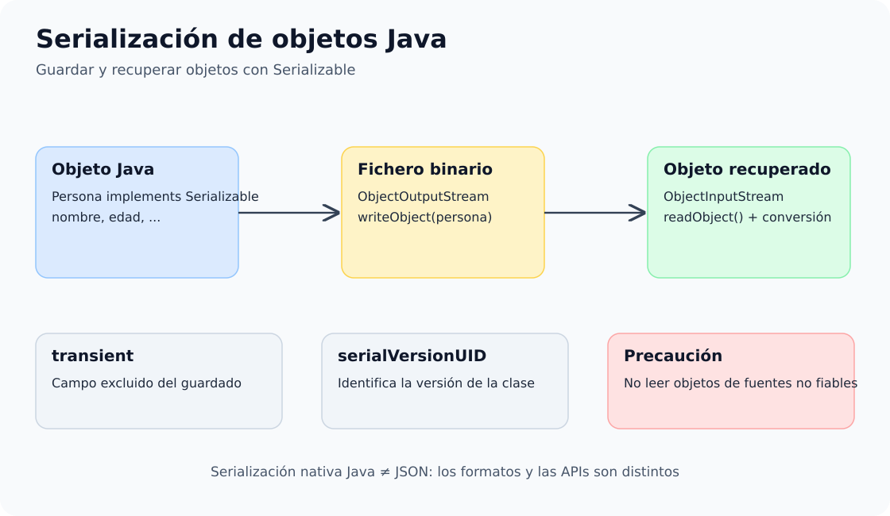

# 2. Serialización y deserialización de objetos

Serializar consiste en convertir un objeto en una secuencia de bytes para almacenarlo o transmitirlo. Deserializar realiza el proceso inverso.


## Esquema: serialización y deserialización




## Clases fundamentales

- `Serializable`
- `ObjectOutputStream`
- `ObjectInputStream`
- `FileOutputStream`
- `FileInputStream`

## Flujo básico

```text
Objeto Java
   │
   │ writeObject()
   ▼
ObjectOutputStream
   │
   ▼
Fichero binario
   │
   │ readObject()
   ▼
ObjectInputStream
   │
   ▼
Objeto Java
```

## Proyecto de ejemplos

[📦 **Descargar ejemplos de serialización**](../../descargas/ut1/serializacion/code_examples_1-2.zip)


---

## Proyecto Maven y secuencia didáctica

El proyecto de Java 21 incluye modelos `Persona` y `Libro`, demostraciones de `ObjectOutputStream`/`ObjectInputStream`, lectura hasta EOF, listas, append y versionado. **Primero estudia el modelo, luego la escritura de un objeto y finalmente su lectura.** El README explica el orden de los demás ejemplos.

[**Descargar proyecto Maven revisado (Java 21)**](../../descargas/ut1/serializacion/code_examples_1-2.zip)
