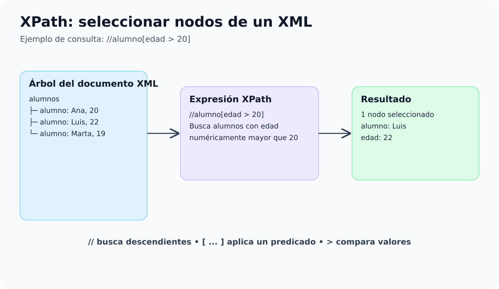

# 5. Consultas sobre XML con XPath

## 5.1. ¿Qué es XPath?

**XPath** (*XML Path Language*) es un lenguaje de expresiones que permite **localizar y consultar nodos de un documento XML**: elementos, atributos, textos y otros nodos. Se utiliza en XSLT, XQuery y aplicaciones Java. **XPath consulta; no modifica el XML.**

La idea es parecida a navegar por carpetas: una ruta identifica una ubicación del árbol XML y un predicado permite filtrar los nodos encontrados.



## Nuestro documento de referencia: `catalogo.xml`

Utilizaremos el ejemplo de tu material original para estudiar las expresiones antes de aplicarlas desde Java.

```xml
<?xml version="1.0" encoding="UTF-8"?>
<!-- Catálogo de productos de ejemplo -->
<catalogo>
    <producto id="P01" categoria="periféricos">
        <nombre>Teclado mecánico</nombre>
        <precio moneda="EUR">49.99</precio>
        <descripcion>Teclado con retroiluminación LED</descripcion>
    </producto>
    <producto id="P02" categoria="periféricos">
        <nombre>Ratón inalámbrico</nombre>
        <precio moneda="EUR">29.50</precio>
        <descripcion>Ratón con sensor óptico de alta precisión</descripcion>
    </producto>
    <producto id="P03" categoria="pantallas">
        <nombre>Monitor 24 pulgadas</nombre>
        <precio moneda="EUR">179.00</precio>
        <descripcion>Resolución Full HD con panel IPS</descripcion>
    </producto>
</catalogo>
```

### Reconocer los nodos

| Tipo de nodo | Ejemplo | Observación |
|---|---|---|
| Documento | Documento XML completo | Es el contexto de una ruta absoluta. |
| Elemento | `<producto>`, `<precio>` | Puede contener atributos, texto y otros elementos. |
| Atributo | `id="P01"`, `moneda="EUR"` | Se consulta con `@`. |
| Texto | `Teclado mecánico` | Se puede seleccionar con `text()`. |
| Comentario | `<!-- ... -->` | Se puede seleccionar con `comment()`. |

!!! note "Una precisión importante"
    La línea `<?xml version="1.0" encoding="UTF-8"?>` es una **declaración XML**, no una instrucción de procesamiento ordinaria.

## ¿Qué puede devolver XPath?

Una expresión puede devolver un **conjunto de nodos**, un **nodo**, una **cadena**, un **número** o un **booleano**. En Java elegimos el tipo esperado al evaluar la expresión.

| Expresión | Interpretación | Resultado con el catálogo |
|---|---|---|
| `//producto` | Localizar productos | Tres elementos `<producto>`. |
| `//producto[@id='P02']/nombre/text()` | Texto del nombre del P02 | `Ratón inalámbrico`. |
| `count(//producto)` | Contar productos | `3`. |
| `boolean(//producto[@id='P04'])` | ¿Existe el P04? | `false`. |

## Itinerario del apartado

1. [Rutas, selectores y ejes](01-rutas-selectores.md).
2. [Predicados y filtros](02-predicados.md).
3. [Funciones XPath](03-funciones.md).
4. [Uso de XPath desde Java](04-java.md).
5. [Resumen y autoevaluación](05-resumen.md).

[📦 Descargar proyecto Java XPath](../../descargas/ut1/xpath/xpath-example.zip)
