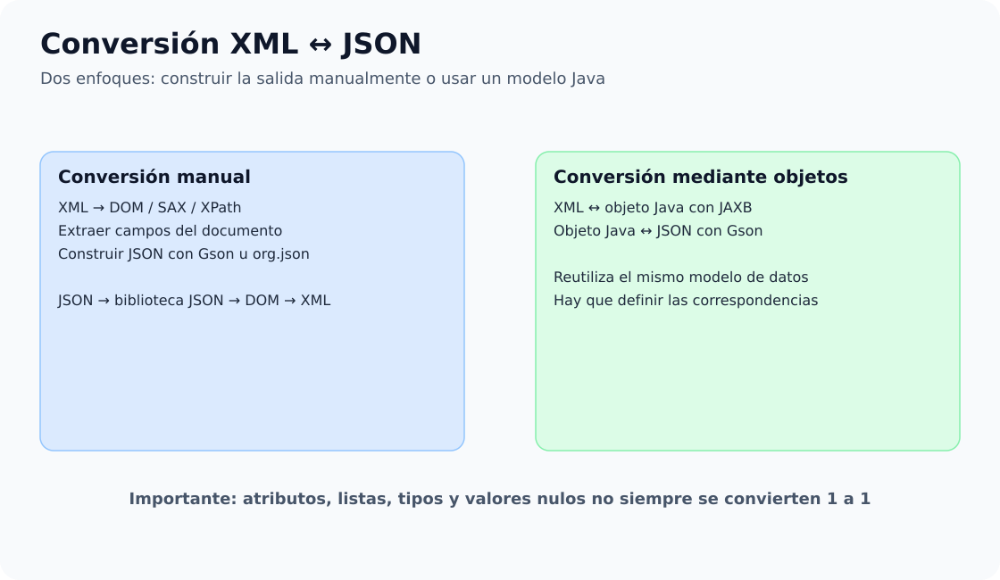

# 6. Conversión XML ↔ JSON

En este bloque utilizaremos **dos proyectos Maven con Java 21**. Ambos convierten información de clientes entre XML y JSON, pero emplean estrategias distintas.

[**Descargar los dos proyectos de conversión**](../../descargas/ut1/conversion/code_Example_1-6.zip)


## Mapa conceptual: enfoques de conversión XML y JSON




## Qué contiene la descarga

```text
conversion-manual/
  pom.xml
  resources/clientes.xml
  resources/clientes.json
  src/main/java/com/example/
    xmltojson/XmlToJsonManual1.java
    xmltojson/XmlToJsonManual2.java
    xmltojson/XmlToJsonManual3.java
    xmltojson/handlers/ClienteHandler.java
    jsontoxml/JsonToXmlManual1.java
    jsontoxml/JsonToXmlManual2_Recursivo.java

conversion-automatica/
  pom.xml
  resources/clientes.xml
  resources/clientes.json
  src/main/java/com/example/
    xmltojson/XmlToJsonAutomatica1.java
    xmltojson/modelo/Cliente.java, Clientes.java
    jsontoxml/JsonToXmlAutomatico1.java
    jsontoxml/modelo/Cliente.java, Clientes.java
```

## Orden didáctico

| Orden | Programa | Qué aprenderás |
|---|---|---|
| 1 | `XmlToJsonManual1` | DOM y creación de JSON |
| 2 | `XmlToJsonManual2` | Consultas XPath y JSON |
| 3 | `ClienteHandler` + `XmlToJsonManual3` | SAX y eventos |
| 4 | `JsonToXmlManual1` | Gson y construcción DOM |
| 5 | `JsonToXmlManual2_Recursivo` | Objetos y arrays anidados |
| 6 | Modelos `Cliente` / `Clientes` | Correspondencia entre objetos Java y XML |
| 7 | `XmlToJsonAutomatica1` | JAXB → objetos → Gson |
| 8 | `JsonToXmlAutomatico1` | Gson → objetos → JAXB |

Abre **cada proyecto por separado** en VS Code, desde la carpeta que contiene su `pom.xml`. Ejecuta las clases con la carpeta del proyecto como directorio de trabajo, ya que utilizan rutas relativas `resources/` y escriben los resultados en `salida/`.

!!! note "Alcance"
    Los ejemplos se centran en clientes con `id`, `nombre` y `edad`. No constituyen una herramienta genérica capaz de conservar todos los detalles de cualquier XML o JSON.
