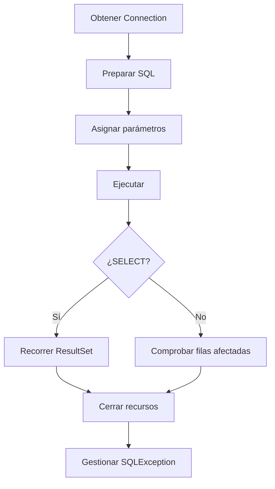

# 2.1 · Conceptos y fundamentos de JDBC

## ¿Qué es JDBC?

**JDBC (Java Database Connectivity)** es la API estándar que permite a una aplicación Java comunicarse con un SGBD mediante interfaces como `Connection`, `Statement`, `PreparedStatement` y `ResultSet`. El driver del fabricante implementa esas interfaces y se encarga de hablar el protocolo de la base de datos.

La ventaja principal es que gran parte del código Java puede mantenerse cuando cambia el gestor; **no significa que todas las sentencias SQL sean portables** ni que todas las funciones estén disponibles en todos los SGBD.


## Gestores embebidos e independientes

| Tipo | Ejemplo | Características |
|---|---|---|
| Embebido | SQLite | Normalmente almacena los datos en un archivo y no requiere servidor independiente |
| Cliente-servidor | MySQL, PostgreSQL | Servicio de BD independiente; admite conexiones por red y varios usuarios |

En los ejercicios utilizaremos **MySQL**. SQLite y PostgreSQL se presentan como comparación conceptual para comprender el criterio de evaluación b).

## Tipos de drivers JDBC

| Tipo | Arquitectura | Situación |
|---|---|---|
| 1 | Puente JDBC–ODBC | Histórico; eliminado del JDK desde Java 8 |
| 2 | API nativa | Depende de librerías nativas |
| 3 | Middleware | Requiere un servidor intermedio |
| 4 | Protocolo nativo desde Java | Habitual para MySQL, PostgreSQL y SQLite |

!!! note "Código antiguo de los apuntes"
    Los ejemplos de drivers de tipo 1, 2 y 3 se estudian como **arquitecturas históricas**; algunos nombres de clases de esos ejemplos son ilustrativos y no representan drivers reales instalables en Java 21. No intentes ejecutarlos.

## Preparación con Maven

El `pom.xml` de los proyectos incluye el driver MySQL Connector/J. Una configuración de referencia es:

```xml
<properties>
  <project.build.sourceEncoding>UTF-8</project.build.sourceEncoding>
  <maven.compiler.release>21</maven.compiler.release>
</properties>
<dependencies>
  <dependency>
    <groupId>com.mysql</groupId>
    <artifactId>mysql-connector-j</artifactId>
    <version>9.3.0</version>
  </dependency>
</dependencies>
```

Maven descarga el driver y lo incorpora al classpath. En JDBC moderno normalmente **no hace falta** llamar a `Class.forName("com.mysql.cj.jdbc.Driver")` cuando el driver está correctamente disponible.

## La URL JDBC

```text
jdbc:mysql://localhost:3306/curso
     │         │     │    └── Base de datos
     │         │     └─────── Puerto
     │         └───────────── Servidor
     └─────────────────────── Subprotocolo MySQL
```

- `localhost`: servidor en el mismo equipo.
- `3306`: puerto habitual de MySQL, configurable.
- `curso`: base de datos de los ejemplos de sentencias y consultas.
- `empresa`: base de datos utilizada para las transacciones.

## Ciclo de vida de una operación JDBC



## Primera conexión

```java
try (Connection conexion = ConexionBD.abrir()) {
    System.out.println("Conexión establecida: " + !conexion.isClosed());
} catch (SQLException e) {
    System.err.println("Error de conexión: " + e.getMessage());
}
```

`ConexionBD` es una clase auxiliar incluida en cada proyecto descargable. Lee la URL, el usuario y la contraseña de variables de entorno; así evitamos publicar credenciales dentro del código.

### Ejercicios de comprensión

1. Identifica qué componente traduce las operaciones JDBC al protocolo MySQL.
2. Explica por qué un driver tipo 1 no es adecuado para JDK 21.
3. Indica la diferencia entre un gestor embebido y uno cliente-servidor.
4. Explica qué ocurre si el servidor MySQL no está iniciado.
5. ¿Qué recurso debe cerrarse incluso si se produce una excepción?
