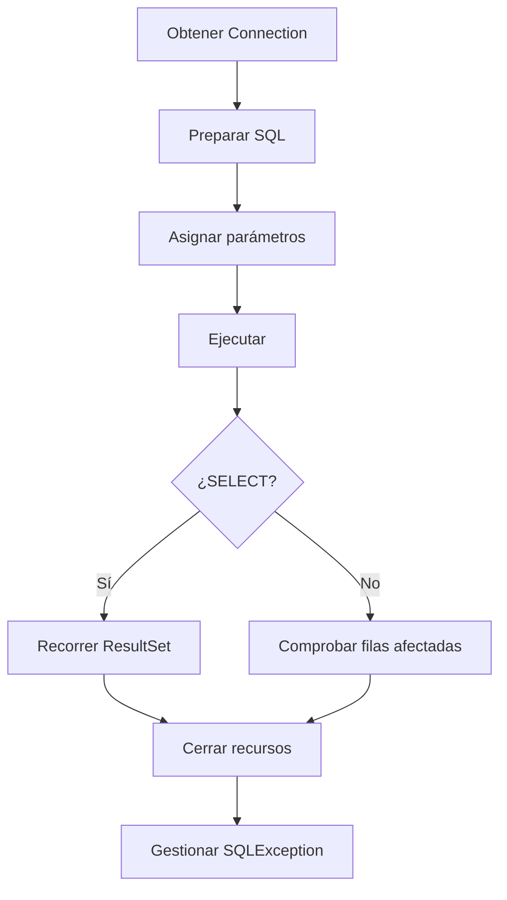

# 2.1 · Conceptos y fundamentos de JDBC

## ¿Qué es JDBC?

**JDBC (Java Database Connectivity)** es la API estándar que permite a una aplicación Java comunicarse con un SGBD mediante interfaces como `Connection`, `Statement`, `PreparedStatement` y `ResultSet`. El driver del fabricante implementa esas interfaces y se encarga de hablar el protocolo de la base de datos.

La ventaja principal es que gran parte del código Java puede mantenerse cuando cambia el gestor; **no significa que todas las sentencias SQL sean portables** ni que todas las funciones estén disponibles en todos los SGBD.


## Gestores embebidos e independientes

| Tipo | Ejemplo | Características |
|---|---|---|
| Embebido | SQLite | Normalmente almacena los datos en un archivo y no requiere servidor independiente |
| Cliente-servidor | MySQL, PostgreSQL | Servicio de BD independiente; admite conexiones por red y varios usuarios |

En los ejercicios utilizaremos **MySQL**. SQLite y PostgreSQL se presentan como comparación conceptual para comprender el criterio de evaluación b).

## Tipos de drivers JDBC

| Tipo | Arquitectura | Situación |
|---|---|---|
| 1 | Puente JDBC–ODBC | Histórico; eliminado del JDK desde Java 8 |
| 2 | API nativa | Depende de librerías nativas |
| 3 | Middleware | Requiere un servidor intermedio |
| 4 | Protocolo nativo desde Java | Habitual para MySQL, PostgreSQL y SQLite |

!!! note "Código antiguo de los apuntes"
    Los ejemplos de drivers de tipo 1, 2 y 3 se estudian como **arquitecturas históricas**; algunos nombres de clases de esos ejemplos son ilustrativos y no representan drivers reales instalables en Java 21. No intentes ejecutarlos.

## Preparación con Maven

El `pom.xml` de los proyectos incluye el driver MySQL Connector/J. Una configuración de referencia es:

```xml
<properties>
  <project.build.sourceEncoding>UTF-8</project.build.sourceEncoding>
  <maven.compiler.release>21</maven.compiler.release>
</properties>
<dependencies>
  <dependency>
    <groupId>com.mysql</groupId>
    <artifactId>mysql-connector-j</artifactId>
    <version>9.3.0</version>
  </dependency>
</dependencies>
```

Maven descarga el driver y lo incorpora al classpath. En JDBC moderno normalmente **no hace falta** llamar a `Class.forName("com.mysql.cj.jdbc.Driver")` cuando el driver está correctamente disponible.

## La URL JDBC

```text
jdbc:mysql://localhost:3306/curso
     │         │     │    └── Base de datos
     │         │     └─────── Puerto
     │         └───────────── Servidor
     └─────────────────────── Subprotocolo MySQL
```

- `localhost`: servidor en el mismo equipo.
- `3306`: puerto habitual de MySQL, configurable.
- `curso`: base de datos de los ejemplos de sentencias y consultas.
- `empresa`: base de datos utilizada para las transacciones.

## Configuración de la conexión: `System.getenv()` y variables de entorno

En los proyectos de esta unidad, la clase `ConexionBD` obtiene los datos de conexión mediante **variables de entorno**. Son valores que proporciona el sistema operativo al proceso que ejecuta Java. Así podemos cambiar de equipo, usuario o contraseña **sin modificar ni publicar el código fuente**.

### ¿Qué hace `System.getenv()`?

`System` es una clase de Java (`java.lang.System`) y `getenv()` permite consultar las variables de entorno del proceso:

- `System.getenv("JDBC_PASSWORD")` busca una variable llamada `JDBC_PASSWORD`. Devuelve su valor como `String` o `null` si no existe.
- `System.getenv()` **sin argumentos** devuelve un `Map<String, String>` con las variables de entorno visibles para el proceso.
- `getOrDefault(clave, valorPredeterminado)` es un método de `Map`, **no de `System`**. Devuelve el valor asociado a la clave o, si no existe, el valor predeterminado.

Por eso podemos escribir:

```java
String url = System.getenv().getOrDefault(
        "JDBC_URL", "jdbc:mysql://localhost:3306/curso");
String usuario = System.getenv().getOrDefault("JDBC_USER", "alumno");
String clave = System.getenv("JDBC_PASSWORD");
```

| Variable | Si está definida | Si no está definida |
|---|---|---|
| `JDBC_URL` | Se utiliza su URL | `jdbc:mysql://localhost:3306/curso` |
| `JDBC_USER` | Se utiliza su usuario | `alumno` |
| `JDBC_PASSWORD` | Se utiliza su contraseña | `null`; el proyecto lanza una excepción |

!!! important "¿Por qué la contraseña no tiene valor por defecto?"
    Porque no conviene guardar contraseñas en el código ni incluir una clave de ejemplo que pueda terminar utilizándose en entornos reales. El proyecto comprueba `clave == null || clave.isBlank()` y lanza una `SQLException` explicativa si falta.

### Configurarlas antes de ejecutar el programa

**PowerShell (Windows)**, en la misma sesión desde la que se inicia Java o el IDE:

```powershell
$env:JDBC_URL = "jdbc:mysql://localhost:3306/curso"
$env:JDBC_USER = "alumno"
$env:JDBC_PASSWORD = "TU_CLAVE_LOCAL"
```

**Terminal Linux (Bash)**:

```bash
export JDBC_URL="jdbc:mysql://localhost:3306/curso"
export JDBC_USER="alumno"
export JDBC_PASSWORD="TU_CLAVE_LOCAL"
```

Estas asignaciones son temporales y se aplican a los procesos iniciados desde esa sesión. **Si el IDE ya estaba abierto, es posible que no reciba las variables nuevas**: reinícialo desde la terminal configurada o utiliza la configuración de entorno de ejecución del IDE. No confundas las variables de entorno con las propiedades de Java consultadas mediante `System.getProperty()`.

!!! warning "Privacidad"
    No imprimas la contraseña con `System.out.println`, no la incluyas en el repositorio Git y evita que aparezca en capturas. Para comprobar si está configurada, puedes consultar únicamente si existe, sin mostrar su contenido.

### Ejemplo comentado: clase `ConexionBD`

```java
public static Connection abrir() throws SQLException {
    // Obtiene la URL del entorno. Si no existe JDBC_URL, usa MySQL local.
    String url = System.getenv().getOrDefault(
            "JDBC_URL", "jdbc:mysql://localhost:3306/curso");

    // Obtiene el usuario; si no está definido, utiliza "alumno".
    String usuario = System.getenv().getOrDefault("JDBC_USER", "alumno");

    // Obtiene la contraseña. Si no existe, getenv devuelve null.
    String clave = System.getenv("JDBC_PASSWORD");

    // Rechaza una contraseña ausente o formada solo por espacios.
    if (clave == null || clave.isBlank()) {
        throw new SQLException("Falta JDBC_PASSWORD. Configura la variable de entorno antes de ejecutar.");
    }

    // Abre la conexión usando el driver JDBC disponible en Maven.
    return DriverManager.getConnection(url, usuario, clave);
}
```

### Comprueba que lo has entendido

**1. ¿Qué diferencia hay entre `System.getenv("JDBC_USER")` y `System.getenv().getOrDefault("JDBC_USER", "alumno")`?**

??? success "Mostrar solución · Variables de entorno 1"
    La primera expresión devuelve `null` si la variable no existe. La segunda utiliza `"alumno"` como valor alternativo. `getOrDefault` es un método del mapa devuelto por `getenv()`.

**2. ¿Qué sucede si no configuras `JDBC_PASSWORD`?**

??? success "Mostrar solución · Variables de entorno 2"
    `System.getenv("JDBC_PASSWORD")` devuelve `null`; la comprobación de `ConexionBD` lanza una `SQLException` antes de llamar a `DriverManager.getConnection()`.

**3. ¿Por qué un programa Java lanzado desde un IDE abierto previamente puede no ver una variable que acabas de definir en PowerShell?**

??? success "Mostrar solución · Variables de entorno 3"
    Las variables de entorno se heredan cuando se inicia un proceso. Si el IDE ya estaba en ejecución, no recibe automáticamente las nuevas variables de la sesión de PowerShell. Puedes configurar las variables en la ejecución del IDE o iniciarlo de nuevo desde la sesión preparada.

## Ciclo de vida de una operación JDBC



## Primera conexión

```java
try (Connection conexion = ConexionBD.abrir()) {
    System.out.println("Conexión establecida: " + !conexion.isClosed());
} catch (SQLException e) {
    System.err.println("Error de conexión: " + e.getMessage());
}
```

`ConexionBD` es una clase auxiliar incluida en cada proyecto descargable. Lee la URL, el usuario y la contraseña de variables de entorno; así evitamos publicar credenciales dentro del código.

### Ejercicios de comprensión

Intenta responder primero sin consultar los apuntes. Después, haz clic en **Mostrar solución** para comprobar tu respuesta y leer la explicación.

**1. Identifica qué componente traduce las operaciones JDBC al protocolo MySQL.**

??? success "Mostrar solución · Ejercicio 1"
    El **driver JDBC de MySQL (MySQL Connector/J)** implementa las interfaces de JDBC y se encarga de comunicarse con MySQL mediante su protocolo. La aplicación trabaja con interfaces como `Connection` y `PreparedStatement`, mientras que el driver realiza la comunicación específica con el gestor.

    Por tanto, **JDBC define las interfaces** y **el driver aporta la implementación** para MySQL.

**2. Explica por qué un driver tipo 1 no es adecuado para JDK 21.**

??? success "Mostrar solución · Ejercicio 2"
    El driver de **tipo 1** era un puente entre JDBC y ODBC. El puente JDBC–ODBC que se incluía antiguamente en Java **se eliminó del JDK a partir de Java 8**, por lo que no forma parte de JDK 21.

    Para trabajar con MySQL en Java 21 utilizamos normalmente un **driver de tipo 4**, como MySQL Connector/J, que implementa directamente el protocolo del gestor desde Java.

**3. Indica la diferencia entre un gestor embebido y uno cliente-servidor.**

??? success "Mostrar solución · Ejercicio 3"
    Un gestor **embebido**, como SQLite, se integra en la aplicación y normalmente almacena los datos en un archivo, sin requerir un servidor de bases de datos independiente.

    Un gestor **cliente-servidor**, como MySQL o PostgreSQL, funciona mediante un servicio de base de datos al que se conectan las aplicaciones, incluso a través de la red. Puede atender a distintos clientes y usuarios.

    **Ejemplo:** una aplicación puede abrir un archivo SQLite local; para conectarse a MySQL necesita que el servicio MySQL esté disponible.

**4. Explica qué ocurre si el servidor MySQL no está iniciado.**

??? success "Mostrar solución · Ejercicio 4"
    Si la aplicación intenta abrir una conexión y **no hay un servidor MySQL escuchando en la dirección y el puerto configurados**, no podrá establecerla. Normalmente el driver lanzará una **`SQLException`**, que deberá gestionarse.

    El mensaje concreto depende de la causa: servidor detenido, puerto incorrecto, problema de red, etc. Conviene comprobar que MySQL está iniciado y que la URL JDBC contiene el servidor y el puerto correctos.

**5. ¿Qué recurso debe cerrarse incluso si se produce una excepción?**

??? success "Mostrar solución · Ejercicio 5"
    La **conexión JDBC (`Connection`)** debe cerrarse cuando deja de utilizarse, incluso si se produce un error. También deben cerrarse los objetos `Statement` o `PreparedStatement` y los `ResultSet` cuando corresponda.

    La forma recomendada es utilizar **`try-with-resources`**, porque Java cierra automáticamente los recursos declarados en el `try` al salir del bloque, incluso cuando se produce una excepción:

    ```java
    try (Connection conexion = ConexionBD.abrir()) {
        System.out.println("Conexión establecida");
    } catch (SQLException e) {
        System.err.println("Error de conexión: " + e.getMessage());
    }
    ```

    Así evitamos mantener conexiones abiertas innecesariamente.
