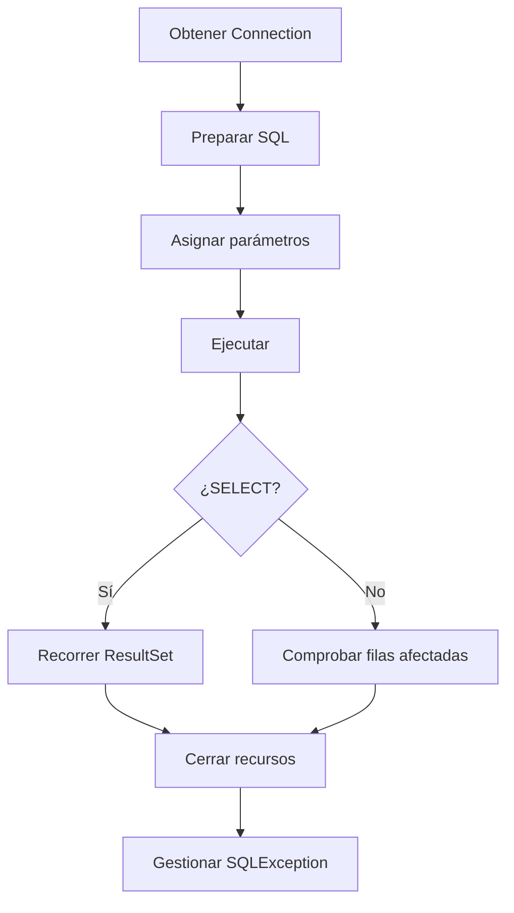

# 2.1 · Conceptos y fundamentos de JDBC

## ¿Qué es JDBC?

**JDBC (Java Database Connectivity)** es la API estándar que permite a una aplicación Java comunicarse con un SGBD mediante interfaces como `Connection`, `Statement`, `PreparedStatement` y `ResultSet`. El driver del fabricante implementa esas interfaces y se encarga de hablar el protocolo de la base de datos.

La ventaja principal es que gran parte del código Java puede mantenerse cuando cambia el gestor; **no significa que todas las sentencias SQL sean portables** ni que todas las funciones estén disponibles en todos los SGBD.


## Gestores embebidos e independientes

| Tipo | Ejemplo | Características |
|---|---|---|
| Embebido | SQLite | Normalmente almacena los datos en un archivo y no requiere servidor independiente |
| Cliente-servidor | MySQL, PostgreSQL | Servicio de BD independiente; admite conexiones por red y varios usuarios |

En los ejercicios utilizaremos **MySQL**. SQLite y PostgreSQL se presentan como comparación conceptual para comprender el criterio de evaluación b).

## Tipos de drivers JDBC

| Tipo | Arquitectura | Situación |
|---|---|---|
| 1 | Puente JDBC–ODBC | Histórico; eliminado del JDK desde Java 8 |
| 2 | API nativa | Depende de librerías nativas |
| 3 | Middleware | Requiere un servidor intermedio |
| 4 | Protocolo nativo desde Java | Habitual para MySQL, PostgreSQL y SQLite |

!!! note "Código antiguo de los apuntes"
    Los ejemplos de drivers de tipo 1, 2 y 3 se estudian como **arquitecturas históricas**; algunos nombres de clases de esos ejemplos son ilustrativos y no representan drivers reales instalables en Java 21. No intentes ejecutarlos.

## Preparación con Maven

El `pom.xml` de los proyectos incluye el driver MySQL Connector/J. Una configuración de referencia es:

```xml
<properties>
  <project.build.sourceEncoding>UTF-8</project.build.sourceEncoding>
  <maven.compiler.release>21</maven.compiler.release>
</properties>
<dependencies>
  <dependency>
    <groupId>com.mysql</groupId>
    <artifactId>mysql-connector-j</artifactId>
    <version>9.3.0</version>
  </dependency>
</dependencies>
```

Maven descarga el driver y lo incorpora al classpath. En JDBC moderno normalmente **no hace falta** llamar a `Class.forName("com.mysql.cj.jdbc.Driver")` cuando el driver está correctamente disponible.

## La URL JDBC

```text
jdbc:mysql://localhost:3306/curso
     │         │     │    └── Base de datos
     │         │     └─────── Puerto
     │         └───────────── Servidor
     └─────────────────────── Subprotocolo MySQL
```

- `localhost`: servidor en el mismo equipo.
- `3306`: puerto habitual de MySQL, configurable.
- `curso`: base de datos de los ejemplos de sentencias y consultas.
- `empresa`: base de datos utilizada para las transacciones.

## Configuración de la conexión: tres versiones para aprender JDBC

Para conectar con MySQL, `DriverManager.getConnection(url, usuario, clave)` necesita tres datos: la dirección de la base de datos, el usuario y la contraseña. **JDBC funciona igual en las tres versiones**; lo que cambia es de dónde obtenemos esos datos.

### V1 · Constantes dentro del código (solo aprendizaje)

Esta primera versión es fácil de comprender: los datos se escriben directamente como constantes de clase.

```java
public final class ConexionBD_V1 {
    private static final String URL = "jdbc:mysql://localhost:3306/curso";
    private static final String USUARIO = "alumno";
    private static final String CLAVE = "clave_de_prueba";

    private ConexionBD_V1() { }

    public static Connection abrir() throws SQLException {
        return DriverManager.getConnection(URL, USUARIO, CLAVE);
    }
}
```

- `private`: solo permite acceder directamente a esas constantes desde la propia clase.
- `static`: pertenecen a la clase, no a cada objeto.
- `final`: impide asignarles otro valor después de inicializarlas.
- **Ninguna de estas palabras cifra ni oculta la contraseña**: se puede leer en el código y puede recuperarse de un JAR.

!!! danger "No guardar contraseñas reales en constantes"
    V1 es **exclusivamente didáctica** y utiliza una cuenta local de pruebas sin datos sensibles. No copies credenciales reales al código, no las subas a GitHub y recuerda que, aunque borres una contraseña de un archivo, puede permanecer en el historial de Git.

### V2 · Archivo de propiedades (`db.properties`)

Esta opción evita escribir la configuración en el código Java. El proyecto Maven incluye `src/main/resources/db.properties.example`, una **plantilla sin credenciales reales**. Cada alumno debe copiarla a `db.properties` y completar los datos de su MySQL local. El fichero real se excluye de Git mediante `.gitignore`.

```properties
# src/main/resources/db.properties (archivo privado)
jdbc.url=jdbc:mysql://localhost:3306/curso
jdbc.user=alumno
jdbc.password=TU_CLAVE_LOCAL
```

La clase `ConexionBD_V2` utiliza `Properties` para cargar ese archivo:

```java
Properties datos = new Properties();
try (InputStream entrada = ConexionBD_V2.class.getClassLoader()
        .getResourceAsStream("db.properties")) {
    if (entrada == null) {
        throw new SQLException("No se encuentra db.properties");
    }
    datos.load(entrada);
} catch (IOException e) {
    throw new SQLException("Error leyendo db.properties", e);
}
String url = datos.getProperty("jdbc.url");
String usuario = datos.getProperty("jdbc.user");
String clave = datos.getProperty("jdbc.password");
return DriverManager.getConnection(url, usuario, clave);
```

`Properties.load()` lee las parejas `clave=valor`; `getProperty()` recupera cada valor. El código anterior resume la idea: **el proyecto descargable comprueba también que no falten valores**. Aunque no esté en Git, un archivo con contraseña puede quedar dentro de los archivos compilados o de un JAR; no distribuyas esos artefactos con credenciales.

!!! info "Conexión en el proyecto `jdbc-preparedstatement`"
    A diferencia de `jdbc-statement`, que presenta tres variantes didácticas, el proyecto **`jdbc-preparedstatement` utiliza únicamente `db.properties`**. Su clase `ConexionBD` carga `jdbc.url`, `jdbc.user` y `jdbc.password` con `Properties`, sin utilizar `System.getenv()`. Copia `src/main/resources/db.properties.example` a `db.properties` y completa los datos de tu MySQL local. El archivo real no debe subirse al repositorio.

### V3 · Variables de entorno (recomendada para despliegues)

En esta versión el sistema operativo proporciona la configuración al programa. Así se pueden cambiar URL, usuario y contraseña **sin modificar el código Java**.

```java
public static Connection abrir() throws SQLException {
    // getenv() devuelve un mapa; getOrDefault es un método de ese mapa.
    String url = System.getenv().getOrDefault(
            "JDBC_URL", "jdbc:mysql://localhost:3306/curso");
    String usuario = System.getenv().getOrDefault("JDBC_USER", "alumno");

    // getenv("NOMBRE") devuelve su valor, o null si no existe.
    String clave = System.getenv("JDBC_PASSWORD");
    if (clave == null || clave.isBlank()) {
        throw new SQLException("Falta JDBC_PASSWORD. Configura la variable de entorno.");
    }
    return DriverManager.getConnection(url, usuario, clave);
}
```

`System` pertenece a `java.lang`. `System.getenv("JDBC_PASSWORD")` busca **una** variable; `System.getenv()` sin argumentos devuelve un `Map<String, String>` con las variables visibles para Java. `getOrDefault()` es un método de `Map`, **no de `System`**. Si falta `JDBC_URL`, usa la URL local; si falta `JDBC_USER`, usa `alumno`; si falta la contraseña, se detiene con una excepción.

#### Cómo definir las variables

En **Windows PowerShell**, antes de iniciar Java desde esa sesión:

```powershell
$env:JDBC_URL = "jdbc:mysql://localhost:3306/curso"
$env:JDBC_USER = "alumno"
$env:JDBC_PASSWORD = "TU_CLAVE_LOCAL"
```

En **Linux (Bash)**:

```bash
export JDBC_URL="jdbc:mysql://localhost:3306/curso"
export JDBC_USER="alumno"
export JDBC_PASSWORD="TU_CLAVE_LOCAL"
```

Las variables son temporales para esa sesión y sus procesos descendientes. Si el IDE ya estaba abierto, puede no heredarlas: configúralas en la ejecución del IDE o inícialo desde la terminal preparada. No muestres contraseñas en la consola, capturas ni repositorios.

### Comparación y seguridad

| Característica | V1 · Constantes | V2 · Properties | V3 · Entorno |
|---|---|---|---|
| Dificultad inicial | Menor | Requiere un archivo | Requiere configurar variables |
| Contraseña en Java | Sí | No | No |
| Cambiar de ordenador | Cambiar código | Cambiar fichero | Cambiar entorno |
| Subir el proyecto a GitHub | Riesgo de revelar claves | Seguro solo si se excluye `db.properties` | Menor riesgo de revelar claves |
| Uso recomendado | Primer ejemplo local | Desarrollo local | Proyectos y despliegues |

!!! note "¿V2 y V3 son completamente seguras?"
    No. Las variables de entorno no cifran por sí solas los secretos y pueden ser visibles para procesos o personas con permisos suficientes. En producción se utilizan además controles de acceso y, cuando procede, gestores de secretos. En aplicaciones de escritorio o móviles distribuidas, **no se debe incorporar una contraseña de la base de datos central**: suele utilizarse una API de servidor que gestione ese acceso.

### ¿Cómo utilizar las tres clases?

El proyecto `jdbc-statement` contiene `ConexionBD_V1`, `ConexionBD_V2`, `ConexionBD_V3` y `DemoConexion`. Al pulsar **Run Java** sobre `DemoConexion`, se prueban **las tres conexiones consecutivamente**, sin argumentos de entrada. Cada intento tiene su propio `try/catch`, por lo que un fallo no detiene los siguientes. `ConexionBD.abrir()` sigue disponible y delega en V3 para mantener la compatibilidad con ejercicios anteriores.

```java
try (Connection c1 = ConexionBD_V1.abrir()) { /* Constantes */ }
try (Connection c2 = ConexionBD_V2.abrir()) { /* db.properties */ }
try (Connection c3 = ConexionBD_V3.abrir()) { /* Variables de entorno */ }
```

Son **tres alternativas independientes**, no tres conexiones que deban mantenerse abiertas a la vez. `try-with-resources` cierra cada conexión. Consulta el `README.md` para preparar el archivo `.properties` y las variables de entorno.

### Comprueba que lo has entendido

**1. ¿Por qué `private static final String CLAVE` no protege una contraseña?**

??? success "Mostrar solución · Constantes"
    `private` limita el acceso desde otras clases y `final` impide reasignar, pero ninguno cifra el valor. Una contraseña literal sigue apareciendo en el código y puede recuperarse de un JAR.

**2. ¿Qué diferencia hay entre `System.getenv("JDBC_USER")` y `System.getenv().getOrDefault("JDBC_USER", "alumno")`?**

??? success "Mostrar solución · Variables de entorno"
    La primera devuelve `null` si no existe la variable. La segunda utiliza `"alumno"` como alternativa. `getOrDefault` pertenece al mapa que devuelve `getenv()`.

**3. ¿Por qué V2 y V3 son preferibles cuando compartimos el proyecto en GitHub?**

??? success "Mostrar solución · Seguridad"
    Porque evitan escribir las credenciales en el código fuente y permite configurarlas en cada entorno. No elimina todos los riesgos: también hay que proteger el equipo, el entorno de ejecución y los permisos de acceso.

**4. ¿Qué pasa si no se configura `JDBC_PASSWORD` en V3?**

??? success "Mostrar solución · Contraseña ausente"
    `System.getenv()` devuelve `null` y la clase lanza una `SQLException` antes de intentar conectarse.

## Ciclo de vida de una operación JDBC



## Primera conexión

```java
try (Connection conexion = ConexionBD.abrir()) {
    System.out.println("Conexión establecida: " + !conexion.isClosed());
} catch (SQLException e) {
    System.err.println("Error de conexión: " + e.getMessage());
}
```

En este proyecto, `ConexionBD.abrir()` delega en `ConexionBD_V3.abrir()`, que lee la configuración desde variables de entorno. Las versiones V1 y V2 quedan disponibles para comparar alternativas.

### Ejercicios de comprensión

Intenta responder primero sin consultar los apuntes. Después, haz clic en **Mostrar solución** para comprobar tu respuesta y leer la explicación.

**1. Identifica qué componente traduce las operaciones JDBC al protocolo MySQL.**

??? success "Mostrar solución · Ejercicio 1"
    El **driver JDBC de MySQL (MySQL Connector/J)** implementa las interfaces de JDBC y se encarga de comunicarse con MySQL mediante su protocolo. La aplicación trabaja con interfaces como `Connection` y `PreparedStatement`, mientras que el driver realiza la comunicación específica con el gestor.

    Por tanto, **JDBC define las interfaces** y **el driver aporta la implementación** para MySQL.

**2. Explica por qué un driver tipo 1 no es adecuado para JDK 21.**

??? success "Mostrar solución · Ejercicio 2"
    El driver de **tipo 1** era un puente entre JDBC y ODBC. El puente JDBC–ODBC que se incluía antiguamente en Java **se eliminó del JDK a partir de Java 8**, por lo que no forma parte de JDK 21.

    Para trabajar con MySQL en Java 21 utilizamos normalmente un **driver de tipo 4**, como MySQL Connector/J, que implementa directamente el protocolo del gestor desde Java.

**3. Indica la diferencia entre un gestor embebido y uno cliente-servidor.**

??? success "Mostrar solución · Ejercicio 3"
    Un gestor **embebido**, como SQLite, se integra en la aplicación y normalmente almacena los datos en un archivo, sin requerir un servidor de bases de datos independiente.

    Un gestor **cliente-servidor**, como MySQL o PostgreSQL, funciona mediante un servicio de base de datos al que se conectan las aplicaciones, incluso a través de la red. Puede atender a distintos clientes y usuarios.

    **Ejemplo:** una aplicación puede abrir un archivo SQLite local; para conectarse a MySQL necesita que el servicio MySQL esté disponible.

**4. Explica qué ocurre si el servidor MySQL no está iniciado.**

??? success "Mostrar solución · Ejercicio 4"
    Si la aplicación intenta abrir una conexión y **no hay un servidor MySQL escuchando en la dirección y el puerto configurados**, no podrá establecerla. Normalmente el driver lanzará una **`SQLException`**, que deberá gestionarse.

    El mensaje concreto depende de la causa: servidor detenido, puerto incorrecto, problema de red, etc. Conviene comprobar que MySQL está iniciado y que la URL JDBC contiene el servidor y el puerto correctos.

**5. ¿Qué recurso debe cerrarse incluso si se produce una excepción?**

??? success "Mostrar solución · Ejercicio 5"
    La **conexión JDBC (`Connection`)** debe cerrarse cuando deja de utilizarse, incluso si se produce un error. También deben cerrarse los objetos `Statement` o `PreparedStatement` y los `ResultSet` cuando corresponda.

    La forma recomendada es utilizar **`try-with-resources`**, porque Java cierra automáticamente los recursos declarados en el `try` al salir del bloque, incluso cuando se produce una excepción:

    ```java
    try (Connection conexion = ConexionBD.abrir()) {
        System.out.println("Conexión establecida");
    } catch (SQLException e) {
        System.err.println("Error de conexión: " + e.getMessage());
    }
    ```

    Así evitamos mantener conexiones abiertas innecesariamente.
