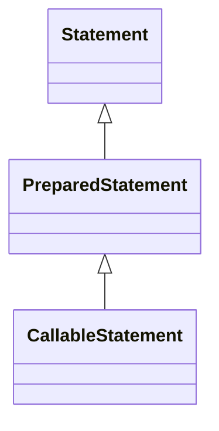

# 2.2 · Sentencias DDL y DML con JDBC

## SQL: DDL, DML y consultas

| Grupo | Operaciones | Ejemplos |
|---|---|---|
| DDL | Define estructuras | `CREATE TABLE`, `ALTER TABLE`, `DROP TABLE` |
| DML | Modifica filas | `INSERT`, `UPDATE`, `DELETE` |
| Consulta | Recupera datos | `SELECT` |

En MySQL, las sentencias DDL suelen provocar **confirmaciones implícitas**, por lo que no deben tratarse como si fueran operaciones DML reversibles con `rollback()`.

## Jerarquía de interfaces



## Métodos de ejecución

| Método | Para qué se usa | Resultado |
|---|---|---|
| `executeQuery()` | Consulta que devuelve filas | `ResultSet` |
| `executeUpdate()` | INSERT, UPDATE, DELETE y DDL compatibles | Número de filas afectadas; para DDL, normalmente 0 |
| `execute()` | SQL que puede producir distintos resultados | `boolean`: indica si el primer resultado es un `ResultSet` |

### `Statement`: SQL fijo

```java
String sql = "SELECT emp_no, apellido FROM empleados ORDER BY emp_no";
try (Connection con = ConexionBD.abrir();
     Statement stmt = con.createStatement();
     ResultSet rs = stmt.executeQuery(sql)) {
    while (rs.next()) {
        System.out.println(rs.getInt("emp_no") + " - " + rs.getString("apellido"));
    }
}
```

`Statement` es útil para explicar las operaciones básicas o ejecutar SQL fijo. **No concatenes valores procedentes del usuario** para construir consultas.

### `PreparedStatement`: parámetros y seguridad

```java
String sql = "SELECT emp_no, apellido FROM empleados WHERE dep_no = ?";
try (Connection con = ConexionBD.abrir();
     PreparedStatement ps = con.prepareStatement(sql)) {
    ps.setInt(1, 30); // Los parámetros se numeran desde 1.
    try (ResultSet rs = ps.executeQuery()) {
        while (rs.next()) {
            System.out.println(rs.getString("apellido"));
        }
    }
}
```

El driver separa la estructura SQL de los valores de los parámetros; así se evita la inyección SQL **en los valores correctamente parametrizados**. No se pueden parametrizar nombres de tablas o columnas mediante `?`: si necesitas SQL dinámico con identificadores, utiliza una lista blanca.

**Rendimiento:** un `PreparedStatement` puede reutilizarse y beneficiarse de la preparación, pero **no está garantizado** que cada consulta se precompile una única vez en el servidor: depende del driver y su configuración.

### Ejemplo de inserción

```java
String sql = "INSERT INTO productos (producto_no, descripcion, precio_actual, stock_disponible) VALUES (?, ?, ?, ?)";
try (Connection con = ConexionBD.abrir();
     PreparedStatement ps = con.prepareStatement(sql)) {
    ps.setInt(1, 9001);
    ps.setString(2, "Teclado de prácticas");
    ps.setBigDecimal(3, new BigDecimal("29.95"));
    ps.setInt(4, 10);
    int filas = ps.executeUpdate();
    System.out.println("Filas insertadas: " + filas);
}
```

Se utiliza `BigDecimal` para cantidades monetarias, evitando errores de precisión habituales de `float` y `double`.

## `CallableStatement`: procedimientos almacenados

Un procedimiento reside en MySQL y puede tener parámetros `IN`, `OUT` e `INOUT`.

```sql
DELIMITER //
CREATE PROCEDURE contarEmpleados(OUT total INT)
BEGIN
    SELECT COUNT(*) INTO total FROM empleados;
END //
DELIMITER ;
```

```java
try (Connection con = ConexionBD.abrir();
     CallableStatement cs = con.prepareCall("{call contarEmpleados(?)}")) {
    cs.registerOutParameter(1, Types.INTEGER);
    cs.execute();
    System.out.println("Empleados: " + cs.getInt(1));
}
```

El proyecto descargable incluye además un procedimiento con parámetro `INOUT` y otro que modifica salarios (este último no se ejecuta automáticamente).

## Ejercicios

1. Crea una tabla de registro mediante `Statement`.
2. Inserta un producto con `PreparedStatement`.
3. Consulta productos cuyo precio sea inferior a un límite introducido por teclado.
4. Actualiza el stock y comprueba las filas afectadas.
5. Ejecuta `contarEmpleados` y explica por qué `registerOutParameter()` es necesario.

**Descargas:** [Statement, PreparedStatement y CallableStatement](07-descargas.md).
