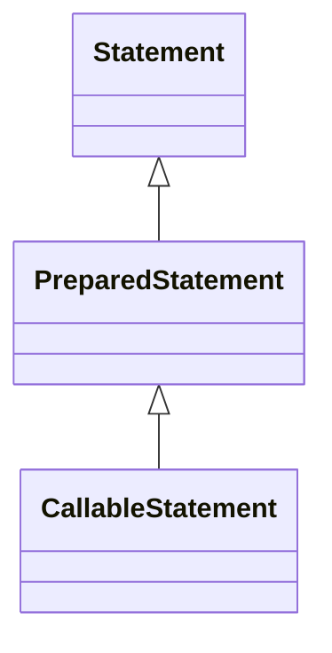

# 2.2 · Sentencias DDL y DML con JDBC

## SQL: DDL, DML y consultas

| Grupo | Operaciones | Ejemplos |
|---|---|---|
| DDL | Define estructuras | `CREATE TABLE`, `ALTER TABLE`, `DROP TABLE` |
| DML | Modifica filas | `INSERT`, `UPDATE`, `DELETE` |
| Consulta | Recupera datos | `SELECT` |

En MySQL, las sentencias DDL suelen provocar **confirmaciones implícitas**, por lo que no deben tratarse como si fueran operaciones DML reversibles con `rollback()`.

## Jerarquía de interfaces



## Métodos de ejecución

| Método | Para qué se usa | Resultado |
|---|---|---|
| `executeQuery()` | Consulta que devuelve filas | `ResultSet` |
| `executeUpdate()` | INSERT, UPDATE, DELETE y DDL compatibles | Número de filas afectadas; para DDL, normalmente 0 |
| `execute()` | SQL que puede producir distintos resultados | `boolean`: indica si el primer resultado es un `ResultSet` |

### `Statement`: SQL fijo

```java
String sql = "SELECT emp_no, apellido FROM empleados ORDER BY emp_no";
try (Connection con = ConexionBD.abrir();
     Statement stmt = con.createStatement();
     ResultSet rs = stmt.executeQuery(sql)) {
    while (rs.next()) {
        System.out.println(rs.getInt("emp_no") + " - " + rs.getString("apellido"));
    }
}
```

`Statement` es útil para explicar las operaciones básicas o ejecutar SQL fijo. **No concatenes valores procedentes del usuario** para construir consultas.

### `PreparedStatement`: parámetros y seguridad

```java
String sql = "SELECT emp_no, apellido FROM empleados WHERE dep_no = ?";
try (Connection con = ConexionBD.abrir();
     PreparedStatement ps = con.prepareStatement(sql)) {
    ps.setInt(1, 30); // Los parámetros se numeran desde 1.
    try (ResultSet rs = ps.executeQuery()) {
        while (rs.next()) {
            System.out.println(rs.getString("apellido"));
        }
    }
}
```

El driver separa la estructura SQL de los valores de los parámetros; así se evita la inyección SQL **en los valores correctamente parametrizados**. No se pueden parametrizar nombres de tablas o columnas mediante `?`: si necesitas SQL dinámico con identificadores, utiliza una lista blanca.

**Rendimiento:** un `PreparedStatement` puede reutilizarse y beneficiarse de la preparación, pero **no está garantizado** que cada consulta se precompile una única vez en el servidor: depende del driver y su configuración.

### Ejemplo de inserción

```java
String sql = "INSERT INTO productos (producto_no, descripcion, precio_actual, stock_disponible) VALUES (?, ?, ?, ?)";
try (Connection con = ConexionBD.abrir();
     PreparedStatement ps = con.prepareStatement(sql)) {
    ps.setInt(1, 9001);
    ps.setString(2, "Teclado de prácticas");
    ps.setBigDecimal(3, new BigDecimal("29.95"));
    ps.setInt(4, 10);
    int filas = ps.executeUpdate();
    System.out.println("Filas insertadas: " + filas);
}
```

Se utiliza `BigDecimal` para cantidades monetarias, evitando errores de precisión habituales de `float` y `double`.

## `CallableStatement`: procedimientos almacenados

Un procedimiento reside en MySQL y puede tener parámetros `IN`, `OUT` e `INOUT`.

```sql
DELIMITER //
CREATE PROCEDURE contarEmpleados(OUT total INT)
BEGIN
    SELECT COUNT(*) INTO total FROM empleados;
END //
DELIMITER ;
```

```java
try (Connection con = ConexionBD.abrir();
     CallableStatement cs = con.prepareCall("{call contarEmpleados(?)}")) {
    cs.registerOutParameter(1, Types.INTEGER);
    cs.execute();
    System.out.println("Empleados: " + cs.getInt(1));
}
```

El proyecto descargable incluye además un procedimiento con parámetro `INOUT` y otro que modifica salarios (este último no se ejecuta automáticamente).

## Ejercicios

Intenta resolver cada ejercicio antes de desplegar la solución. Los ejemplos son orientativos y deben adaptarse a la base de datos y al proyecto Maven de prácticas.

**1. Crea una tabla de registro mediante `Statement`.**

??? success "Mostrar solución · Ejercicio 1"
    Una posible tabla para registrar operaciones de la aplicación es `registro_operaciones`. Utiliza `executeUpdate()` porque `CREATE TABLE` no devuelve un `ResultSet`.

    ```java
    String sql = """
        CREATE TABLE IF NOT EXISTS registro_operaciones (
            id INT AUTO_INCREMENT PRIMARY KEY,
            descripcion VARCHAR(200) NOT NULL,
            fecha TIMESTAMP DEFAULT CURRENT_TIMESTAMP
        )
        """;
    try (Connection con = ConexionBD.abrir();
         Statement st = con.createStatement()) {
        st.executeUpdate(sql);
        System.out.println("Tabla preparada");
    }
    ```

    **Comprobación:** ejecuta `SHOW TABLES` o `DESCRIBE registro_operaciones` en MySQL. El valor devuelto por `executeUpdate()` para DDL no representa filas insertadas; en MySQL suele ser `0`. Ejecuta DDL solo sobre una base de prácticas.


**2. Inserta un producto con `PreparedStatement`.**

??? success "Mostrar solución · Ejercicio 2"
    ```java
    String sql = """
        INSERT INTO productos
        (producto_no, descripcion, precio_actual, stock_disponible)
        VALUES (?, ?, ?, ?)
        """;
    try (Connection con = ConexionBD.abrir();
         PreparedStatement ps = con.prepareStatement(sql)) {
        ps.setInt(1, 9002);
        ps.setString(2, "Ratón de prácticas");
        ps.setBigDecimal(3, new BigDecimal("14.50"));
        ps.setInt(4, 15);
        int filas = ps.executeUpdate();
        System.out.println("Filas insertadas: " + filas);
    }
    ```

    **Resultado esperado:** `1` fila insertada, si el identificador no existe y se cumplen las restricciones. Usa los imports de `java.sql` y `java.math.BigDecimal`. Repite la consulta en MySQL para verificar la inserción.


**3. Consulta productos cuyo precio sea inferior a un límite introducido por teclado.**

??? success "Mostrar solución · Ejercicio 3"
    ```java
    Scanner teclado = new Scanner(System.in);
    System.out.print("Precio máximo: ");
    BigDecimal limite = new BigDecimal(teclado.nextLine());
    String sql = """
        SELECT producto_no, descripcion, precio_actual
        FROM productos WHERE precio_actual < ?
        ORDER BY precio_actual
        """;
    try (Connection con = ConexionBD.abrir();
         PreparedStatement ps = con.prepareStatement(sql)) {
        ps.setBigDecimal(1, limite);
        try (ResultSet rs = ps.executeQuery()) {
            boolean encontrado = false;
            while (rs.next()) {
                encontrado = true;
                System.out.printf("%d - %s: %s €%n",
                    rs.getInt("producto_no"),
                    rs.getString("descripcion"),
                    rs.getBigDecimal("precio_actual"));
            }
            if (!encontrado) System.out.println("Sin resultados");
        }
    }
    ```

    El límite se introduce como **valor parametrizado**, no se concatena al SQL. Controla `NumberFormatException` cuando integres este ejemplo en un menú.


**4. Actualiza el stock y comprueba las filas afectadas.**

??? success "Mostrar solución · Ejercicio 4"
    ```java
    String sql = "UPDATE productos SET stock_disponible = ? WHERE producto_no = ?";
    try (Connection con = ConexionBD.abrir();
         PreparedStatement ps = con.prepareStatement(sql)) {
        ps.setInt(1, 20);
        ps.setInt(2, 9002);
        int filas = ps.executeUpdate();
        if (filas == 1) {
            System.out.println("Stock actualizado");
        } else if (filas == 0) {
            System.out.println("Producto inexistente o sin filas afectadas");
        } else {
            System.out.println("Revisar actualización: " + filas);
        }
    }
    ```

    **Comprobación:** consulta el stock antes y después. La interpretación exacta del número de filas de `UPDATE` puede depender de la configuración del driver y de si se cuentan filas encontradas o modificadas.


**5. Ejecuta `contarEmpleados` y explica por qué `registerOutParameter()` es necesario.**

??? success "Mostrar solución · Ejercicio 5"
    ```java
    try (Connection con = ConexionBD.abrir();
         CallableStatement cs = con.prepareCall("{call contarEmpleados(?)}")) {
        cs.registerOutParameter(1, Types.INTEGER);
        cs.execute();
        int total = cs.getInt(1);
        System.out.println("Empleados: " + total);
    }
    ```

    `registerOutParameter(1, Types.INTEGER)` indica que el primer parámetro es **de salida** y cuál es su tipo SQL. Después de ejecutar el procedimiento, `getInt(1)` recupera el valor devuelto. El procedimiento debe haberse creado previamente con el script SQL correspondiente.


**Descargas:** [Statement, PreparedStatement y CallableStatement](07-descargas.md).
