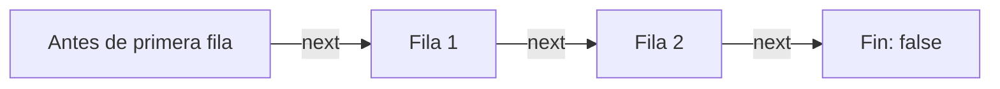

# 2.3 · Procesamiento de resultados y metadatos

## El objeto `ResultSet`

`executeQuery()` devuelve un `ResultSet`, que representa las filas resultantes de una consulta. Habitualmente se recorre mediante un **cursor**. No debe asumirse que todos los resultados se cargan íntegramente en memoria: el comportamiento depende del driver y su configuración.



```java
try (Connection con = ConexionBD.abrir();
     PreparedStatement ps = con.prepareStatement(
         "SELECT emp_no, apellido, salario FROM empleados WHERE dep_no = ?")) {
    ps.setInt(1, 30);
    try (ResultSet rs = ps.executeQuery()) {
        while (rs.next()) {
            int numero = rs.getInt("emp_no");
            String apellido = rs.getString("apellido");
            BigDecimal salario = rs.getBigDecimal("salario");
            System.out.printf("%d | %s | %s%n", numero, apellido, salario);
        }
    }
}
```

El cursor comienza **antes de la primera fila**; `next()` lo avanza y devuelve `false` cuando no quedan filas. Los índices de columna, si se utilizan en lugar de nombres, empiezan en **1**.

## Tipos de cursores

| Constante | Comportamiento |
|---|---|
| `TYPE_FORWARD_ONLY` | Avance hacia delante; el tipo habitual por defecto |
| `TYPE_SCROLL_INSENSITIVE` | Desplazable; normalmente no refleja cambios externos |
| `TYPE_SCROLL_SENSITIVE` | Solicita reflejar cambios externos, si el driver lo admite |

```java
try (Connection con = ConexionBD.abrir();
     Statement st = con.createStatement(
         ResultSet.TYPE_SCROLL_INSENSITIVE,
         ResultSet.CONCUR_READ_ONLY);
     ResultSet rs = st.executeQuery("SELECT emp_no, apellido FROM empleados")) {
    if (rs.last()) {
        System.out.println("Último empleado: " + rs.getString("apellido"));
    }
}
```

!!! warning "Compatibilidad"
    El soporte real de cursores desplazables, sensibles y actualizables **depende del driver y de la consulta**. Solicitar un tipo no garantiza que esté disponible; se pueden consultar las capacidades con `DatabaseMetaData`.

## `ResultSetMetaData`

Permite descubrir la estructura de las columnas devueltas por una consulta.

| Método | Información |
|---|---|
| `getColumnCount()` | Número de columnas |
| `getColumnLabel(i)` | Etiqueta visible, incluido un alias `AS` |
| `getColumnName(i)` | Nombre de columna, según el driver |
| `getColumnTypeName(i)` | Nombre del tipo SQL |
| `isNullable(i)` | Posibilidad de valores `NULL` |
| `getColumnDisplaySize(i)` | Tamaño de presentación recomendado |

```java
ResultSetMetaData meta = rs.getMetaData();
for (int i = 1; i <= meta.getColumnCount(); i++) {
    System.out.printf("%s (%s)%n", meta.getColumnLabel(i), meta.getColumnTypeName(i));
}
```

## `NULL` y tipos de datos

- `getString()` y `getBigDecimal()` devuelven `null` para valores SQL nulos.
- `getInt()` devuelve `0` tanto si el valor es cero como si es `NULL`; utiliza `rs.wasNull()` si necesitas distinguirlos.
- Para dinero, prefiere `DECIMAL` en MySQL y `BigDecimal` en Java.

## `ResultSet` actualizables

Algunos drivers admiten `CONCUR_UPDATABLE` para modificar filas desde el cursor (`updateXxx`, `updateRow`, `insertRow`, `deleteRow`). La consulta debe cumplir restricciones del driver; por ejemplo, suele necesitar una tabla y su clave primaria.

En aplicaciones ordinarias es preferible utilizar `UPDATE`, `INSERT` y `DELETE` mediante `PreparedStatement`, porque la operación queda explícita y es más fácil comprobar las filas afectadas.

## Ejercicios

1. Lista empleados por departamento, indicando si la consulta no devuelve filas.
2. Muestra nombre, tipo y número de columnas de una consulta con alias.
3. Comprueba la diferencia entre `getColumnLabel()` y `getColumnName()`.
4. Explica por qué `getInt()` puede requerir `wasNull()`.
5. Investiga si tu driver permite `TYPE_SCROLL_SENSITIVE`.

**Proyecto:** [jdbc-resultados](07-descargas.md).
