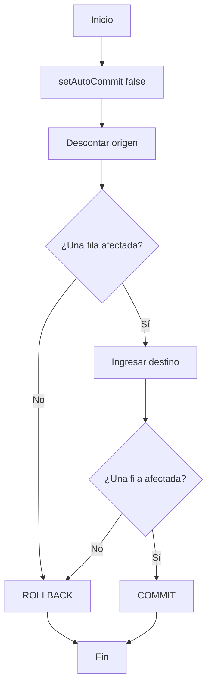

# 2.4 · Transacciones y control de errores

## ¿Qué es una transacción?

Una transacción agrupa operaciones que deben tratarse como una unidad lógica. En una transferencia bancaria, **restar dinero de una cuenta e ingresarlo en otra** deben confirmarse juntas o deshacerse juntas.

## Propiedades ACID

| Propiedad | Significado | Ejemplo |
|---|---|---|
| Atomicidad | Todas las operaciones o ninguna | No se descuenta dinero si no puede ingresarse |
| Consistencia | Se mantienen las restricciones y reglas | No se admite saldo negativo |
| Aislamiento | Se controlan los efectos de transacciones concurrentes | Evitar lecturas inconsistentes |
| Durabilidad | Los cambios confirmados persisten | Un `COMMIT` confirmado sobrevive a fallos conforme a las garantías del motor |



## Transacciones con JDBC

Los métodos principales pertenecen a `Connection`:

| Método | Función |
|---|---|
| `setAutoCommit(false)` | Activa control manual de la transacción |
| `commit()` | Confirma cambios |
| `rollback()` | Deshace cambios pendientes |
| `setSavepoint()` | Crea una marca intermedia |
| `rollback(savepoint)` | Deshace desde la marca |

### Ejemplo completo: servicio de transferencia

```java
try (Connection con = ConexionBD.abrir()) {
    con.setAutoCommit(false);
    try {
        int origen = cuentaDAO.descontar(con, 1, new BigDecimal("20.00"));
        int destino = cuentaDAO.ingresar(con, 2, new BigDecimal("20.00"));
        if (origen != 1 || destino != 1) {
            throw new SQLException("La transferencia no pudo completarse");
        }
        con.commit();
    } catch (SQLException e) {
        try {
            con.rollback();
        } catch (SQLException errorRollback) {
            e.addSuppressed(errorRollback);
        }
        throw e;
    }
}
```

En el proyecto completo el DAO **recibe la conexión del servicio**; si cada operación abriera su propia conexión, no estarían dentro de la misma transacción. La actualización del origen usa `WHERE saldo >= ?` para impedir descubiertos y comprueba que se ha actualizado exactamente una fila.

!!! warning "MySQL y transacciones"
    Para estos ejemplos utiliza **InnoDB**. No introduzcas instrucciones DDL dentro de la transacción esperando deshacerlas con `rollback()`: muchas provocan confirmación implícita en MySQL.

## Aislamiento y anomalías

| Nivel JDBC | Lecturas sucias | Lecturas no repetibles | Fantasmas según el modelo SQL |
|---|---|---|---|
| `READ_UNCOMMITTED` | Posibles | Posibles | Posibles |
| `READ_COMMITTED` | Evitadas | Posibles | Posibles |
| `REPEATABLE_READ` | Evitadas | Evitadas | Pueden ser posibles según el estándar; InnoDB tiene matices |
| `SERIALIZABLE` | Evitadas | Evitadas | Evitados |

- **Lectura sucia:** leer datos que otra transacción aún no ha confirmado.
- **Lectura no repetible:** releer una fila y obtener un valor distinto por una confirmación concurrente.
- **Fantasma:** una consulta repetida devuelve un conjunto distinto de filas que cumplen la condición.

Los detalles exactos dependen del motor y de cómo implementa bloqueos y versiones. En MySQL/InnoDB el nivel habitual por defecto es `REPEATABLE READ`.

## `Savepoint`: deshacer parcialmente

```java
con.setAutoCommit(false);
Savepoint punto = con.setSavepoint("ANTES_ALBARAN");
try {
    // Crear un albarán asociado a un pedido ya registrado.
    insertarAlbaran(con, 1001);
} catch (SQLException e) {
    con.rollback(punto); // Conserva operaciones anteriores a la marca.
}
con.commit();
```

Este fragmento es **esquemático**: `insertarAlbaran` representa una operación que implementarás en el DAO. Un `Savepoint` no debe utilizarse para dividir una transferencia que, por definición, debe ser indivisible.

## Ejercicios

Intenta resolver cada ejercicio antes de desplegar la solución. Los ejemplos son orientativos y deben adaptarse a la base de datos y al proyecto Maven de prácticas.

**1. Ejecuta una transferencia válida y comprueba ambos saldos.**

??? success "Mostrar solución · Ejercicio 1"
    Prepara dos cuentas de prueba, por ejemplo, origen con **100,00 €** y destino con **50,00 €**. Transfiere **20,00 €** utilizando el servicio del proyecto `jdbc-transacciones`.

    **Resultado esperado:** origen **80,00 €**, destino **70,00 €**, siempre que no haya otras operaciones concurrentes. Verifica los saldos con una consulta `SELECT` antes y después. Ambas actualizaciones deben usar **la misma `Connection`** y confirmarse con `commit()`.


**2. Intenta transferir más saldo del disponible; verifica que no cambian los saldos.**

??? success "Mostrar solución · Ejercicio 2"
    Con origen **100,00 €** y destino **50,00 €**, intenta transferir **150,00 €**.

    La operación de descuento debe impedir saldos negativos mediante una condición como:

    ```sql
    UPDATE cuentas
    SET saldo = saldo - ?
    WHERE id = ? AND saldo >= ?;
    ```

    Los nombres `cuentas`, `id` y `saldo` son orientativos; usa los del proyecto. Si no se actualiza exactamente una fila, el servicio debe lanzar un error y ejecutar `rollback()`. **Resultado esperado:** ambos saldos permanecen en 100,00 € y 50,00 €.


**3. Intenta ingresar en una cuenta inexistente; verifica que se deshace el descuento.**

??? success "Mostrar solución · Ejercicio 3"
    Utiliza una cuenta de origen válida y un identificador de destino que no exista en la tabla. El primer `UPDATE` puede descontar el importe, pero el segundo afectará a **cero filas**.

    ```java
    if (filasOrigen != 1 || filasDestino != 1) {
        throw new SQLException("No se pudo completar la transferencia");
    }
    ```

    El `catch` debe ejecutar `con.rollback()`. **Comprobación:** vuelve a consultar el saldo del origen; debe ser igual al inicial. Esto demuestra la **atomicidad** de la transacción.


**4. Explica qué sucedería si el DAO abriese una conexión nueva para cada actualización.**

??? success "Mostrar solución · Ejercicio 4"
    Cada actualización podría ejecutarse en **una transacción distinta**, especialmente si las conexiones tienen `autoCommit` activado. Si se confirma el descuento y falla el ingreso, el `rollback()` de otra conexión **no puede deshacer el descuento ya confirmado**.

    **Solución de diseño:** el servicio abre una sola conexión, desactiva `autoCommit` y se la pasa a los métodos del DAO. El servicio es quien decide `commit()` o `rollback()` para toda la operación.


**5. Diseña un caso en el que sí tenga sentido utilizar `Savepoint`.**

??? success "Mostrar solución · Ejercicio 5"
    **Ejemplo:** registrar un pedido y, después, intentar crear un albarán opcional. Si falla el albarán, se desea conservar el pedido.

    1. Se inicia la transacción y se registra el pedido.
    2. Se crea `Savepoint punto = con.setSavepoint("PEDIDO_CREADO")`.
    3. Se intenta insertar el albarán.
    4. Si falla, se ejecuta `con.rollback(punto)`.
    5. Se confirma el pedido con `con.commit()`.

    **Condición:** la lógica de negocio debe permitir que el pedido exista sin albarán. No uses este enfoque en una transferencia bancaria, porque sus dos movimientos son indivisibles.


**Proyecto:** [jdbc-transacciones](07-descargas.md).
