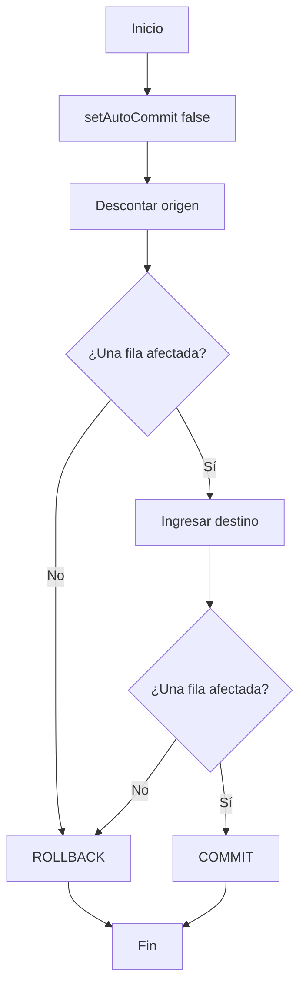

# 2.4 · Transacciones y control de errores

## ¿Qué es una transacción?

Una transacción agrupa operaciones que deben tratarse como una unidad lógica. En una transferencia bancaria, **restar dinero de una cuenta e ingresarlo en otra** deben confirmarse juntas o deshacerse juntas.

## Propiedades ACID

| Propiedad | Significado | Ejemplo |
|---|---|---|
| Atomicidad | Todas las operaciones o ninguna | No se descuenta dinero si no puede ingresarse |
| Consistencia | Se mantienen las restricciones y reglas | No se admite saldo negativo |
| Aislamiento | Se controlan los efectos de transacciones concurrentes | Evitar lecturas inconsistentes |
| Durabilidad | Los cambios confirmados persisten | Un `COMMIT` confirmado sobrevive a fallos conforme a las garantías del motor |



## Transacciones con JDBC

Los métodos principales pertenecen a `Connection`:

| Método | Función |
|---|---|
| `setAutoCommit(false)` | Activa control manual de la transacción |
| `commit()` | Confirma cambios |
| `rollback()` | Deshace cambios pendientes |
| `setSavepoint()` | Crea una marca intermedia |
| `rollback(savepoint)` | Deshace desde la marca |

### Ejemplo completo: servicio de transferencia

```java
try (Connection con = ConexionBD.abrir()) {
    con.setAutoCommit(false);
    try {
        int origen = cuentaDAO.descontar(con, 1, new BigDecimal("20.00"));
        int destino = cuentaDAO.ingresar(con, 2, new BigDecimal("20.00"));
        if (origen != 1 || destino != 1) {
            throw new SQLException("La transferencia no pudo completarse");
        }
        con.commit();
    } catch (SQLException e) {
        try {
            con.rollback();
        } catch (SQLException errorRollback) {
            e.addSuppressed(errorRollback);
        }
        throw e;
    }
}
```

En el proyecto completo el DAO **recibe la conexión del servicio**; si cada operación abriera su propia conexión, no estarían dentro de la misma transacción. La actualización del origen usa `WHERE saldo >= ?` para impedir descubiertos y comprueba que se ha actualizado exactamente una fila.

!!! warning "MySQL y transacciones"
    Para estos ejemplos utiliza **InnoDB**. No introduzcas instrucciones DDL dentro de la transacción esperando deshacerlas con `rollback()`: muchas provocan confirmación implícita en MySQL.

## Aislamiento y anomalías

| Nivel JDBC | Lecturas sucias | Lecturas no repetibles | Fantasmas según el modelo SQL |
|---|---|---|---|
| `READ_UNCOMMITTED` | Posibles | Posibles | Posibles |
| `READ_COMMITTED` | Evitadas | Posibles | Posibles |
| `REPEATABLE_READ` | Evitadas | Evitadas | Pueden ser posibles según el estándar; InnoDB tiene matices |
| `SERIALIZABLE` | Evitadas | Evitadas | Evitados |

- **Lectura sucia:** leer datos que otra transacción aún no ha confirmado.
- **Lectura no repetible:** releer una fila y obtener un valor distinto por una confirmación concurrente.
- **Fantasma:** una consulta repetida devuelve un conjunto distinto de filas que cumplen la condición.

Los detalles exactos dependen del motor y de cómo implementa bloqueos y versiones. En MySQL/InnoDB el nivel habitual por defecto es `REPEATABLE READ`.

## `Savepoint`: deshacer parcialmente

```java
con.setAutoCommit(false);
Savepoint punto = con.setSavepoint("ANTES_ALBARAN");
try {
    // Crear un albarán asociado a un pedido ya registrado.
    insertarAlbaran(con, 1001);
} catch (SQLException e) {
    con.rollback(punto); // Conserva operaciones anteriores a la marca.
}
con.commit();
```

Este fragmento es **esquemático**: `insertarAlbaran` representa una operación que implementarás en el DAO. Un `Savepoint` no debe utilizarse para dividir una transferencia que, por definición, debe ser indivisible.

## Ejercicios

1. Ejecuta una transferencia válida y comprueba ambos saldos.
2. Intenta transferir más saldo del disponible; verifica que no cambian los saldos.
3. Intenta ingresar en una cuenta inexistente; verifica que se deshace el descuento.
4. Explica qué sucedería si el DAO abriese una conexión nueva para cada actualización.
5. Diseña un caso en el que sí tenga sentido utilizar `Savepoint`.

**Proyecto:** [jdbc-transacciones](07-descargas.md).
