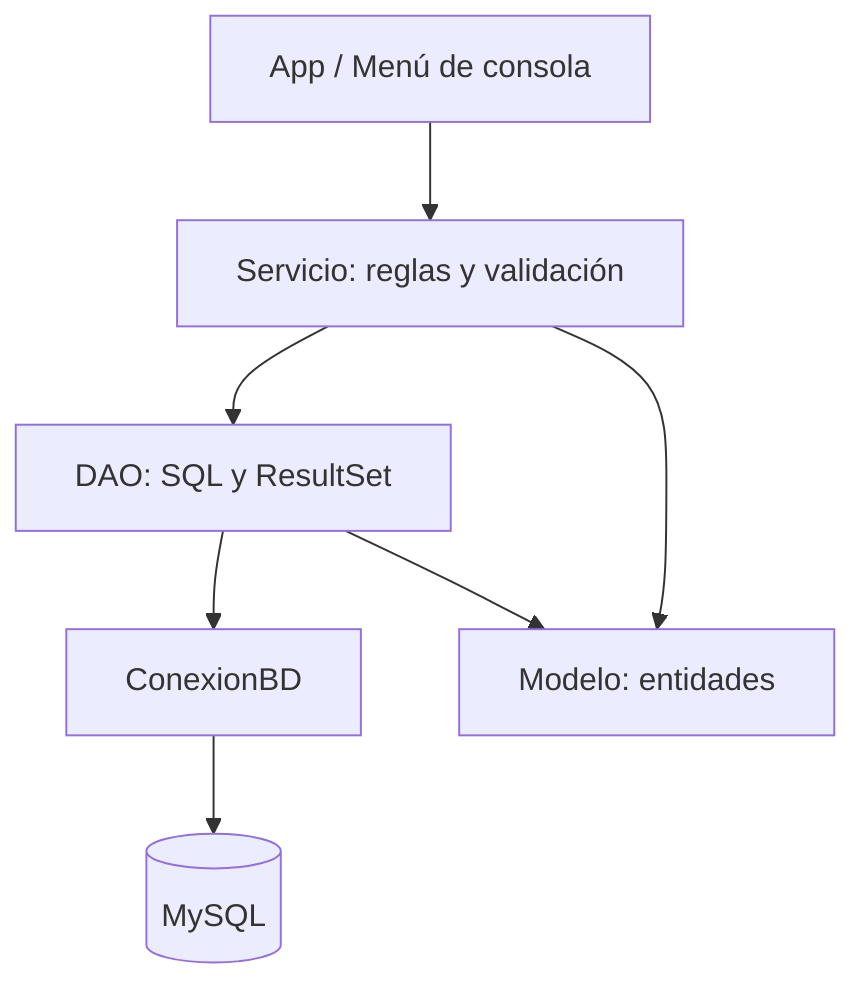

# 2.5 · Buenas prácticas y organización del código JDBC

## Separación de responsabilidades



| Capa | Responsabilidad | Qué NO debe hacer |
|---|---|---|
| Presentación | Leer opciones y mostrar mensajes | Escribir SQL |
| Servicio | Validar reglas y coordinar transacciones | Pedir datos con `Scanner` |
| DAO | Ejecutar SQL y transformar resultados | Mostrar menús |
| Modelo | Representar los datos | Abrir conexiones |
| Configuración | Centralizar parámetros JDBC | Guardar contraseñas en Git |

No es obligatorio aplicar todas las capas en una primera demostración de `Statement`. En el CRUD y en las transferencias, esta separación evita mezclar responsabilidades.

## `try-with-resources`

```java
try (Connection con = ConexionBD.abrir();
     PreparedStatement ps = con.prepareStatement("SELECT apellido FROM empleados");
     ResultSet rs = ps.executeQuery()) {
    while (rs.next()) {
        System.out.println(rs.getString("apellido"));
    }
}
```

Los recursos se cierran en orden inverso al de su creación, incluso si se produce una excepción. Para una consulta con parámetros, primero se prepara y configura el `PreparedStatement` y luego se abre el `ResultSet` en un segundo bloque `try`.

## Errores SQL

```java
catch (SQLException e) {
    System.err.println("Mensaje: " + e.getMessage());
    System.err.println("SQLState: " + e.getSQLState());
    System.err.println("Código del proveedor: " + e.getErrorCode());
}
```

No muestres trazas completas ni credenciales al usuario final. En prácticas, `SQLState` y el código del proveedor ayudan a diagnosticar problemas de conexión, permisos o restricciones.

## Reglas de seguridad y calidad

1. Usar `PreparedStatement` para **valores variables**.
2. No guardar contraseñas en código ni subirlas al repositorio.
3. Utilizar cuentas de MySQL con permisos mínimos.
4. Comprobar el número de filas afectadas tras `UPDATE` y `DELETE`.
5. Usar `BigDecimal` para dinero y columnas SQL `DECIMAL`.
6. No usar `SELECT *` cuando se conocen las columnas necesarias.
7. Mantener las transacciones cortas y utilizar una sola conexión.
8. Usar nombres descriptivos y comentarios que expliquen el *porqué*.
9. Separar los scripts de creación de datos del código Java.
10. Probar casos correctos, inexistentes, nulos y de error.

## Preguntas para revisar un proyecto

- ¿Qué clase contiene SQL y por qué?
- ¿Qué ocurre si la conexión falla?
- ¿Qué pasa cuando `executeUpdate()` devuelve cero?
- ¿Se cierran `Connection`, `PreparedStatement` y `ResultSet`?
- ¿Se comprueba el resultado de cada paso antes de confirmar una transacción?
- ¿Es posible explicar el código sin consultar una solución externa?
