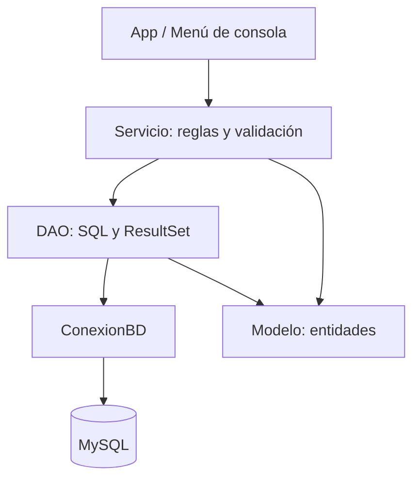

# 2.5 · Buenas prácticas y organización del código JDBC

## Separación de responsabilidades



| Capa | Responsabilidad | Qué NO debe hacer |
|---|---|---|
| Presentación | Leer opciones y mostrar mensajes | Escribir SQL |
| Servicio | Validar reglas y coordinar transacciones | Pedir datos con `Scanner` |
| DAO | Ejecutar SQL y transformar resultados | Mostrar menús |
| Modelo | Representar los datos | Abrir conexiones |
| Configuración | Centralizar parámetros JDBC | Guardar contraseñas en Git |

No es obligatorio aplicar todas las capas en una primera demostración de `Statement`. En el CRUD y en las transferencias, esta separación evita mezclar responsabilidades.

## `try-with-resources`

```java
try (Connection con = ConexionBD.abrir();
     PreparedStatement ps = con.prepareStatement("SELECT apellido FROM empleados");
     ResultSet rs = ps.executeQuery()) {
    while (rs.next()) {
        System.out.println(rs.getString("apellido"));
    }
}
```

Los recursos se cierran en orden inverso al de su creación, incluso si se produce una excepción. Para una consulta con parámetros, primero se prepara y configura el `PreparedStatement` y luego se abre el `ResultSet` en un segundo bloque `try`.

## Errores SQL

```java
catch (SQLException e) {
    System.err.println("Mensaje: " + e.getMessage());
    System.err.println("SQLState: " + e.getSQLState());
    System.err.println("Código del proveedor: " + e.getErrorCode());
}
```

No muestres trazas completas ni credenciales al usuario final. En prácticas, `SQLState` y el código del proveedor ayudan a diagnosticar problemas de conexión, permisos o restricciones.

## Reglas de seguridad y calidad

1. Usar `PreparedStatement` para **valores variables**.
2. No guardar contraseñas en código ni subirlas al repositorio.
3. Utilizar cuentas de MySQL con permisos mínimos.
4. Comprobar el número de filas afectadas tras `UPDATE` y `DELETE`.
5. Usar `BigDecimal` para dinero y columnas SQL `DECIMAL`.
6. No usar `SELECT *` cuando se conocen las columnas necesarias.
7. Mantener las transacciones cortas y utilizar una sola conexión.
8. Usar nombres descriptivos y comentarios que expliquen el *porqué*.
9. Separar los scripts de creación de datos del código Java.
10. Probar casos correctos, inexistentes, nulos y de error.

## Preguntas para revisar un proyecto

Utiliza estas preguntas como una **lista de autoevaluación razonada** antes de entregar tu proyecto. Primero revisa tu propio código y después consulta la explicación.

**1. ¿Qué clase contiene SQL y por qué?**

??? success "Mostrar solución · Ejercicio 1"
    La capa **DAO** debe contener las sentencias SQL y el mapeo de los resultados a objetos del modelo. Así, el menú no necesita conocer la estructura de las tablas y el servicio puede centrarse en reglas de negocio y transacciones.


**2. ¿Qué ocurre si la conexión falla?**

??? success "Mostrar solución · Ejercicio 2"
    `ConexionBD.abrir()` puede lanzar una `SQLException`. La operación debe detenerse y mostrar o registrar un mensaje adecuado, sin exponer contraseñas. El servicio o la capa que gestione la operación decidirá si reintenta, informa del error o aborta. No debe continuar como si existiera una conexión válida.


**3. ¿Qué pasa cuando `executeUpdate()` devuelve cero?**

??? success "Mostrar solución · Ejercicio 3"
    Puede significar que **no se encontró ningún registro** que cumpla la condición o que no hubo filas contadas como afectadas, según la operación y la configuración del driver. En un `DELETE` por clave primaria, normalmente indica que no existía la fila. En una transferencia, si se exige actualizar exactamente una fila, el servicio debe considerarlo un fallo y deshacer la transacción.


**4. ¿Se cierran `Connection`, `PreparedStatement` y `ResultSet`?**

??? success "Mostrar solución · Ejercicio 4"
    Compruébalo revisando los bloques `try-with-resources`:

    ```java
    try (Connection con = ConexionBD.abrir();
         PreparedStatement ps = con.prepareStatement("SELECT emp_no FROM empleados");
         ResultSet rs = ps.executeQuery()) {
        while (rs.next()) {
            System.out.println(rs.getInt("emp_no"));
        }
    }
    ```

    Los tres recursos se cierran automáticamente, también si se lanza una excepción. Si el servicio gestiona una transacción, el DAO **no debe cerrar la conexión recibida** antes de que el servicio haga `commit()` o `rollback()`.


**5. ¿Se comprueba el resultado de cada paso antes de confirmar una transacción?**

??? success "Mostrar solución · Ejercicio 5"
    Una transferencia correcta comprueba que **cada actualización afecta exactamente a una fila** y que se respetan las reglas de saldo. Solo entonces llama a `commit()`. Ante cualquier fallo debe ejecutar `rollback()`; de otro modo puede dejar datos inconsistentes.


**6. ¿Es posible explicar el código sin consultar una solución externa?**

??? success "Mostrar solución · Ejercicio 6"
    Para comprobarlo, intenta justificar sin mirar apuntes: qué hace cada clase, de dónde viene la conexión, por qué se usa `PreparedStatement`, qué sucede si una consulta no encuentra filas, cómo se cierran los recursos y qué provoca un `rollback()`. Si alguna respuesta no está clara, vuelve al bloque correspondiente y reproduce el ejemplo.


