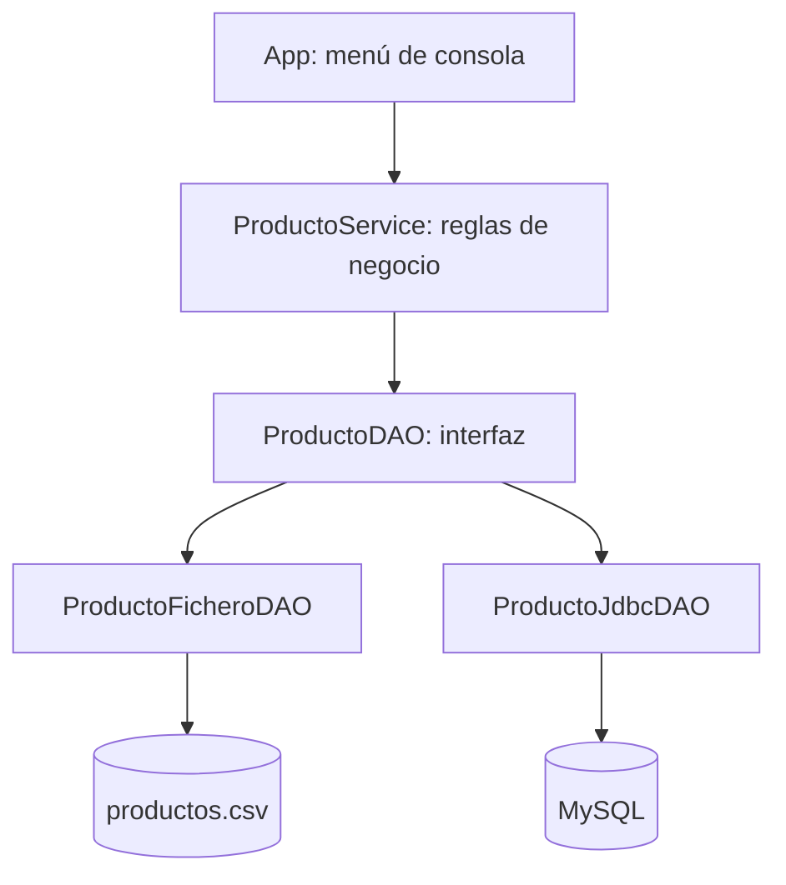

# 3.1. Introducción a la programación orientada a componentes

## Objetivos

- Identificar las responsabilidades de un componente y distinguirlo de una aplicación completa.
- Reconocer las ventajas de encapsulación, reutilización y bajo acoplamiento.
- Conocer el proyecto transversal **Gestión de inventario**, que construiremos durante toda la UT3.

## 1. ¿Qué es un componente de software?

Un **componente** es una unidad de software con una responsabilidad definida que ofrece operaciones mediante una interfaz conocida. Puede integrarse con otros componentes sin que estos necesiten conocer los detalles de su implementación.

En esta unidad no desarrollaremos simplemente otro programa de lectura de ficheros o de consultas JDBC. **Encapsularemos** esas operaciones para que el resto de la aplicación no dependa del mecanismo de almacenamiento.

| Concepto | En nuestro proyecto |
|---|---|
| Encapsulación | El DAO oculta cómo se guardan los productos. |
| Interfaz | `ProductoDAO` define las operaciones disponibles. |
| Implementación | `ProductoFicheroDAO` y `ProductoJdbcDAO` realizan esas operaciones. |
| Reutilización | Una aplicación diferente podría utilizar los mismos DAO. |
| Bajo acoplamiento | `ProductoService` trabaja con la interfaz, no con una clase concreta. |

## 2. Proyecto transversal: Gestión de inventario

Construiremos una aplicación de consola que permita:

1. Dar de alta un producto.
2. Buscarlo por identificador.
3. Listar todos los productos.
4. Modificar precio y existencias.
5. Eliminar un producto.

El modelo será:

| Atributo | Tipo | Restricción didáctica |
|---|---|---|
| `id` | `int` | Mayor que cero; único. |
| `nombre` | `String` | No vacío. |
| `precio` | `double` | Mayor o igual que cero. |
| `stock` | `int` | Mayor o igual que cero. |

!!! note "Decisión para el ejemplo"
    Usamos `double` para simplificar los primeros pasos. En aplicaciones económicas reales suele ser preferible `BigDecimal` para evitar problemas de precisión decimal.

## 3. Arquitectura que construiremos

La aplicación compartirá **modelo, menú y servicio**. Lo que cambia es el componente de persistencia.

## 4. Plan de desarrollo

| Apartado | Resultado |
|---|---|
| 3.2 | Proyecto Maven preparado con Java 21. |
| 3.3 | Modelo, interfaz DAO, servicio y menú. |
| 3.4 | Primera versión funcional con CSV. |
| 3.5 | Segunda implementación con MySQL/JDBC. |
| 3.6 | Pruebas unitarias y documentación. |
| 3.7 | Selección de persistencia y generación del JAR ejecutable. |

## 5. Actividad de inicio

1. Explica por qué no conviene escribir consultas SQL directamente en cada opción del menú.
2. ¿Qué parte debería permanecer igual al pasar de CSV a MySQL?
3. Propón otra implementación de `ProductoDAO` (por ejemplo, memoria o JSON).

??? success "Orientaciones"
    1. Duplicaría código y mezclaría responsabilidades.
    2. El modelo, las operaciones del servicio y la interfaz de usuario.
    3. Cualquier implementación que respete el contrato de la interfaz.

**Continúa con:** [3.2. Herramientas para desarrollar componentes](02-herramientas.md).
