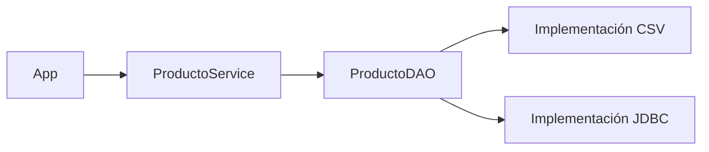

# 3.3. Arquitectura por capas, interfaces y DAO

!!! info "Proyecto de trabajo"
    Continúa con el [proyecto inicial de Gestión de inventario](../descargas/ut3/Gestion_Inventario_Inicial_Java21_Maven.zip). Añade los archivos y las dependencias de este apartado. La solución completa se facilita al finalizar la UT3.


## Objetivos

- Separar presentación, negocio y persistencia.
- Definir un contrato DAO independiente de la tecnología de almacenamiento.
- Crear el modelo y el servicio de la aplicación.

## 1. Separación de responsabilidades

| Capa | Clase | Responsabilidad |
|---|---|---|
| Presentación | `App` | Mostrar menú y recoger datos. |
| Negocio | `ProductoService` | Validar datos y coordinar operaciones. |
| Persistencia | `ProductoDAO` | Definir el contrato CRUD. |
| Persistencia | `ProductoFicheroDAO` / `ProductoJdbcDAO` | Guardar y recuperar datos. |



## 2. Crear el modelo

Archivo: **`src/main/java/es/iesisidra/inventario/modelo/Producto.java`**.

```java
package es.iesisidra.inventario.modelo;

public record Producto(int id, String nombre, double precio, int stock) { }
```

Utilizamos un `record` de Java 21 para representar datos inmutables. Cuando se modifica un producto se crea un nuevo valor con el mismo `id` y los atributos actualizados.

## 3. Definir el contrato DAO

Archivo: **`src/main/java/es/iesisidra/inventario/dao/ProductoDAO.java`**.

```java
package es.iesisidra.inventario.dao;

import es.iesisidra.inventario.modelo.Producto;
import java.util.List;
import java.util.Optional;

public interface ProductoDAO {
    void insertar(Producto producto);
    Optional<Producto> buscarPorId(int id);
    List<Producto> listar();
    boolean actualizar(Producto producto);
    boolean eliminar(int id);
}
```

La interfaz describe **qué operaciones** puede realizar el componente, no **cómo** las ejecuta.

- `Optional<Producto>` permite representar una búsqueda sin resultado.
- `List<Producto>` devuelve los productos existentes.
- `boolean` indica si se ha modificado o eliminado algún registro.
- `insertar` y los demás métodos pueden lanzar excepciones de ejecución cuando falla la persistencia.

## 4. Implementar las reglas de negocio

Archivo: **`src/main/java/es/iesisidra/inventario/servicio/ProductoService.java`**.

```java
package es.iesisidra.inventario.servicio;

import es.iesisidra.inventario.dao.ProductoDAO;
import es.iesisidra.inventario.modelo.Producto;
import java.util.List;
import java.util.Optional;

public class ProductoService {
    private final ProductoDAO dao;

    public ProductoService(ProductoDAO dao) {
        this.dao = dao;
    }

    public void alta(Producto p) {
        validar(p);
        if (dao.buscarPorId(p.id()).isPresent()) {
            throw new IllegalArgumentException("El ID ya existe");
        }
        dao.insertar(p);
    }

    public Optional<Producto> buscar(int id) {
        return dao.buscarPorId(id);
    }

    public List<Producto> listar() {
        return dao.listar();
    }

    public boolean modificar(Producto p) {
        validar(p);
        return dao.actualizar(p);
    }

    public boolean baja(int id) {
        return dao.eliminar(id);
    }

    private void validar(Producto p) {
        if (p.id() <= 0 || p.nombre() == null || p.nombre().isBlank()
                || !Double.isFinite(p.precio()) || p.precio() < 0 || p.stock() < 0) {
            throw new IllegalArgumentException("Datos de producto no válidos");
        }
    }
}
```

!!! important "Inyección de dependencias"
    El servicio recibe un `ProductoDAO` en el constructor. No crea un DAO concreto con `new ProductoFicheroDAO(...)` ni con `new ProductoJdbcDAO(...)`. Esto permite sustituir la persistencia sin modificar el servicio.

## 5. ¿Dónde está el menú?

La clase `App` se añadirá cuando dispongamos de la primera implementación de persistencia, en el apartado 3.4. Así podremos ejecutar operaciones reales desde el primer momento.

## 6. Actividad

1. Añade al modelo un atributo `categoria`. ¿Qué componentes tendrían que adaptarse?
2. Explica por qué `ProductoService` depende de `ProductoDAO` y no de `ProductoFicheroDAO`.
3. Dibuja un diagrama UML de clases con `App`, `ProductoService`, `ProductoDAO` y las dos implementaciones.

**Continúa con:** [3.4. Componentes de acceso a ficheros](04-componentes-ficheros.md).
