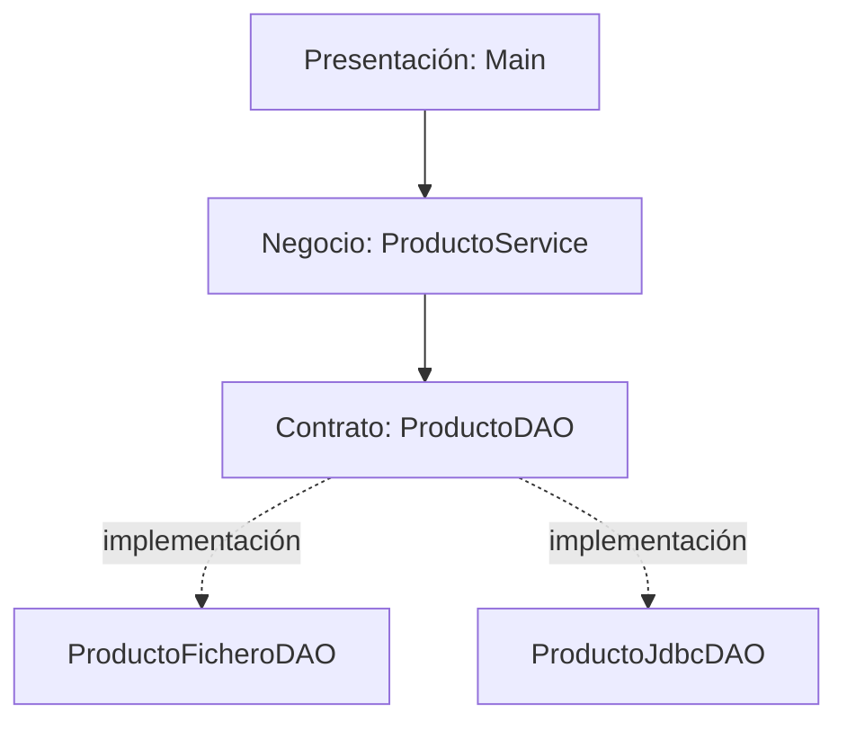
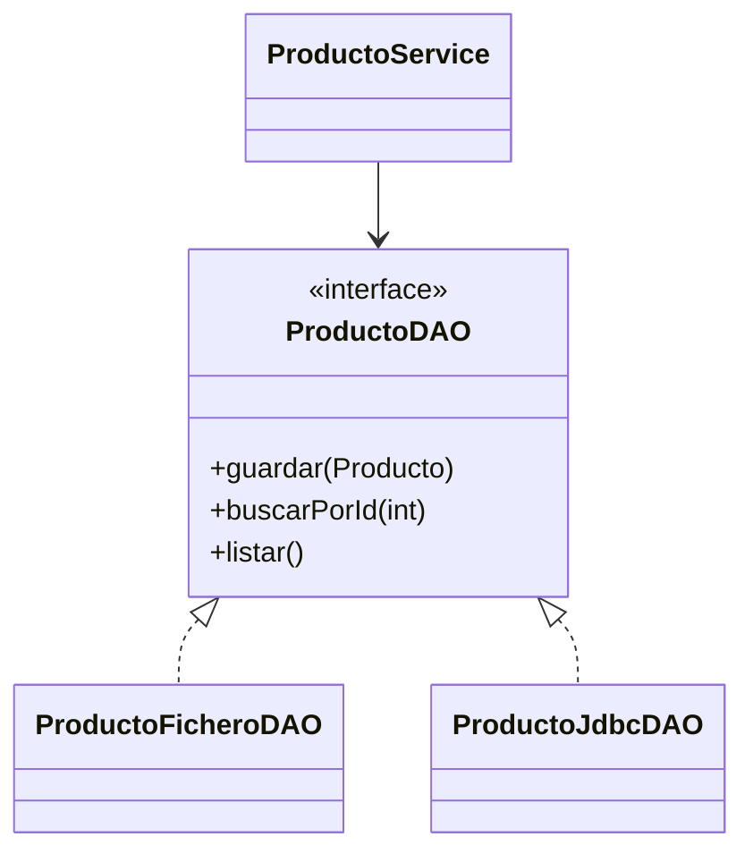

# 3.3. Arquitectura por capas, interfaces y patrón DAO

**Duración orientativa:** 4 horas · **CE a), c), d), i)**

## 1. El problema: mezclar responsabilidades

Imagina que `Main` solicita los datos del producto, calcula descuentos, abre conexiones JDBC y ejecuta SQL. Una modificación en la forma de almacenar productos obliga a cambiar el menú. Esta dependencia dificulta el mantenimiento y las pruebas.

**Pregunta inicial:** si mañana sustituimos MySQL por un CSV, ¿qué clases deberían cambiar?

## 2. Separación de responsabilidades y arquitectura por capas



| Capa | Responsabilidad | Qué no debería hacer |
|---|---|---|
| Presentación | Mostrar menú y recoger opciones. | Ejecutar SQL o leer CSV. |
| Negocio | Aplicar reglas: precio no negativo, campos obligatorios. | Mostrar menús o decidir consultas SQL. |
| Persistencia | Guardar y recuperar productos. | Preguntar datos al usuario. |

Esta división es una **arquitectura didáctica simplificada**. No todas las aplicaciones necesitan exactamente tres capas, pero la separación de responsabilidades es una práctica útil.

## 3. Cohesión y acoplamiento

- **Alta cohesión:** una clase agrupa métodos relacionados con una misma tarea.
- **Bajo acoplamiento:** una clase conoce pocos detalles internos de otras.

### Ejemplo de acoplamiento fuerte

```java
public class ProductoService {
    // El servicio queda unido a una implementación concreta.
    private final ProductoJdbcDAO dao = new ProductoJdbcDAO();
}
```

### Ejemplo de acoplamiento menor

```java
public class ProductoService {
    private final ProductoDAO dao;

    public ProductoService(ProductoDAO dao) {
        this.dao = dao;
    }
}
```

La segunda versión recibe un componente compatible a través del constructor. Así, el servicio puede funcionar con CSV o JDBC sin cambiar su código. Este mecanismo se llama **inyección de dependencias por constructor** y no necesita ningún framework.

## 4. Repaso de POO: interfaces, `implements` y polimorfismo

### 4.1. Declarar una interfaz

```java
public interface Notificador {
    void enviar(String mensaje);
}
```

Una interfaz declara un **contrato**: quien la implemente deberá proporcionar el comportamiento de `enviar`.

### 4.2. Implementar el contrato

```java
public class NotificadorConsola implements Notificador {
    @Override
    public void enviar(String mensaje) {
        System.out.println(mensaje);
    }
}
```

```java
public class NotificadorUrgente implements Notificador {
    @Override
    public void enviar(String mensaje) {
        System.out.println("URGENTE: " + mensaje);
    }
}
```

`implements` indica que la clase implementa la interfaz. `@Override` ayuda a comprobar que estamos sobrescribiendo correctamente el método declarado.

### 4.3. Utilizar polimorfismo

```java
public class Main {
    public static void main(String[] args) {
        Notificador notificador = new NotificadorConsola();
        notificador.enviar("Pedido registrado");

        // La misma variable puede referenciar otra implementación.
        notificador = new NotificadorUrgente();
        notificador.enviar("Pedido pendiente");
    }
}
```

**Salida:**

```text
Pedido registrado
URGENTE: Pedido pendiente
```

El tipo de la variable es `Notificador`, mientras que el objeto real puede ser cualquiera de sus implementaciones.

!!! question "Comprueba que lo entiendes"
    ¿Podríamos declarar `Notificador notificador = new Notificador();`? No: una interfaz no se instancia directamente. Necesitamos una clase concreta que la implemente.

## 5. Interfaces como contratos entre componentes

Ahora aplicamos el mismo principio al acceso a datos:

```java
import java.util.List;
import java.util.Optional;

public interface ProductoDAO {
    void guardar(Producto producto) throws AccesoDatosException;
    Optional<Producto> buscarPorId(int id) throws AccesoDatosException;
    List<Producto> listar() throws AccesoDatosException;
}
```

- `guardar` registra un producto.
- `buscarPorId` devuelve `Optional.empty()` si no existe.
- `listar` devuelve una lista, vacía si no hay registros.
- `AccesoDatosException` representa fallos de acceso al almacenamiento.

!!! note "Contrato y errores"
    La interfaz establece el comportamiento visible; cada implementación decide cómo realizarlo. La excepción `AccesoDatosException` será una clase propia del proyecto descargable. La validación de precios y nombres pertenece a la capa de negocio.

## 6. Patrón DAO

**DAO** significa *Data Access Object*. Encapsula la lógica de acceso al almacenamiento y ofrece operaciones al resto de la aplicación.



El menú **no debe abrir conexiones JDBC** ni interpretar las columnas de un CSV. Para eso existen las implementaciones DAO.

### DAO frente a Repository

Un DAO suele centrarse en operaciones de acceso a un origen de datos concreto. Repository es una abstracción orientada a colecciones de objetos del dominio. Sus métodos pueden parecerse, pero no son exactamente el mismo concepto. **En esta unidad implementaremos DAO**; en la UT4 retomaremos la idea de Repository al estudiar ORM.

## 7. Estructura de paquetes Maven

```text
src/main/java/es/iesisidra/productos/
├── Main.java
├── modelo/
│   └── Producto.java
├── servicio/
│   └── ProductoService.java
└── dao/
    ├── ProductoDAO.java
    ├── AccesoDatosException.java
    ├── ProductoFicheroDAO.java
    └── ProductoJdbcDAO.java
```

## 8. Ejercicios

1. Identifica qué responsabilidades aparecen mezcladas en una clase que contiene `Scanner`, `PreparedStatement` y `System.out.println`.
2. Completa la interfaz `Notificador` con un segundo método `enviarError(String mensaje)` e impleméntalo en ambas clases.
3. Explica por qué `ProductoService(ProductoDAO dao)` permite sustituir el almacenamiento.
4. Dibuja un diagrama de clases UML con la interfaz y las dos implementaciones DAO.
5. Explica qué diferencia hay entre **cambiar el objeto referenciado** y **modificar la clase `ProductoService`**.
6. Indica qué capa debe validar que el precio sea mayor o igual que cero y por qué.

**Criterio de éxito:** comprender la arquitectura antes de escribir los DAO completos de los apartados siguientes.
