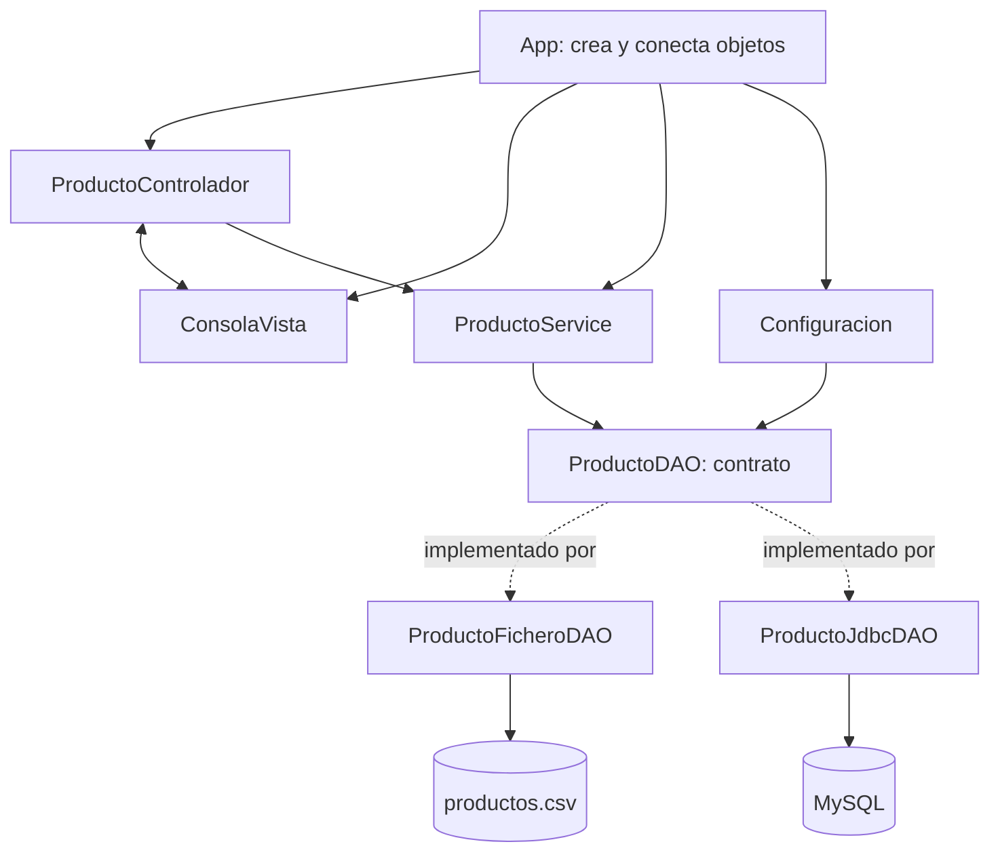

# 3.3. Arquitectura por capas, interfaces y DAO

!!! info "Proyecto de trabajo"
    Continúa con el [proyecto inicial de Gestión de inventario](../descargas/ut3/Gestion_Inventario_Inicial_Java21_Maven.zip). Añade los archivos y las dependencias de este apartado. La solución completa se facilita al finalizar la UT3.


## Objetivos

- Separar presentación, negocio y persistencia.
- Definir un contrato DAO independiente de la tecnología de almacenamiento.
- Crear el modelo y el servicio de la aplicación.

## 1. Separación de responsabilidades: MVC + servicio + DAO

Antes de programar, debemos decidir **qué responsabilidad tiene cada parte**. El DAO encapsula la persistencia, pero no debe gestionar menús. El servicio aplica reglas de negocio, pero no debe leer del teclado. Para separar la interacción con el usuario utilizaremos una **vista** y un **controlador**.


## Arquitectura definitiva: MVC, servicio y DAO

El proyecto conserva el **objetivo del RA6**: desarrollar componentes de acceso a datos reutilizables. El patrón MVC se utiliza para que la aplicación que integra esos componentes sea también un ejemplo de separación de responsabilidades. No sustituye al patrón DAO: **lo complementa**.



| Elemento | Responsabilidad | Qué **no** debe hacer |
|---|---|---|
| `Producto` | Representar los datos del producto (`record`). | Leer del teclado o ejecutar SQL. |
| `ConsolaVista` | Mostrar el menú, solicitar entradas y presentar resultados. | Ejecutar operaciones CRUD en el DAO. |
| `ProductoControlador` | Interpretar la opción elegida y coordinar vista y servicio. | Leer con `Scanner` o construir sentencias SQL. |
| `ProductoService` | Validar datos y aplicar las reglas de negocio. | Mostrar mensajes o elegir CSV/MySQL. |
| `ProductoDAO` | Definir el contrato CRUD. | Imponer una tecnología de persistencia. |
| `ProductoFicheroDAO` / `ProductoJdbcDAO` | Implementar el contrato en CSV / MySQL. | Mostrar el menú. |
| `Configuracion` | Seleccionar la implementación DAO al arrancar. | Contener reglas de negocio. |
| `App` | Crear los objetos y poner en marcha el controlador. | Acumular el menú y todas las operaciones. |

**Recorrido de un alta:** la vista solicita los datos → el controlador recibe un `Producto` → el servicio valida y llama a `ProductoDAO` → el DAO guarda en CSV o MySQL → el controlador pide a la vista mostrar el resultado.

!!! info "MVC en una aplicación de consola"
    MVC no exige una interfaz gráfica. En esta práctica la **vista** es una clase de consola, el **controlador** coordina las acciones del usuario y el **modelo** representa los datos. Añadimos una capa de servicio y el patrón DAO para que las reglas de negocio y el almacenamiento queden separados.

### La configuración también tiene su propia responsabilidad

En la solución final separamos `Configuracion` (leer el archivo `.properties`), `FabricaDao` (elegir la implementación del DAO) y `ConexionBD` (abrir conexiones JDBC). Ninguna de estas clases debe contener el menú ni reglas de negocio.

**Importante:** `App` solo crea y conecta los componentes; no consulta variables de entorno, no contiene SQL y no gestiona el menú.

## 2. Crear el modelo

Archivo: **`src/main/java/es/iesisidra/inventario/modelo/Producto.java`**.

```java
package es.iesisidra.inventario.modelo;

public record Producto(int id, String nombre, double precio, int stock) { }
```

Utilizamos un `record` de Java 21 para representar datos inmutables. Cuando se modifica un producto se crea un nuevo valor con el mismo `id` y los atributos actualizados.

## 3. Definir el contrato DAO

Archivo: **`src/main/java/es/iesisidra/inventario/dao/ProductoDAO.java`**.

```java
package es.iesisidra.inventario.dao;

import es.iesisidra.inventario.modelo.Producto;
import java.util.List;
import java.util.Optional;

public interface ProductoDAO {
    void insertar(Producto producto);
    Optional<Producto> buscarPorId(int id);
    List<Producto> listar();
    boolean actualizar(Producto producto);
    boolean eliminar(int id);
}
```

La interfaz describe **qué operaciones** puede realizar el componente, no **cómo** las ejecuta.

- `Optional<Producto>` permite representar una búsqueda sin resultado.
- `List<Producto>` devuelve los productos existentes.
- `boolean` indica si se ha modificado o eliminado algún registro.
- `insertar` y los demás métodos pueden lanzar excepciones de ejecución cuando falla la persistencia.

## 4. Implementar las reglas de negocio

Archivo: **`src/main/java/es/iesisidra/inventario/servicio/ProductoService.java`**.

```java
package es.iesisidra.inventario.servicio;

import es.iesisidra.inventario.dao.ProductoDAO;
import es.iesisidra.inventario.modelo.Producto;
import java.util.List;
import java.util.Optional;

public class ProductoService {
    private final ProductoDAO dao;

    public ProductoService(ProductoDAO dao) {
        this.dao = dao;
    }

    public void alta(Producto p) {
        validar(p);
        if (dao.buscarPorId(p.id()).isPresent()) {
            throw new IllegalArgumentException("El ID ya existe");
        }
        dao.insertar(p);
    }

    public Optional<Producto> buscar(int id) {
        return dao.buscarPorId(id);
    }

    public List<Producto> listar() {
        return dao.listar();
    }

    public boolean modificar(Producto p) {
        validar(p);
        return dao.actualizar(p);
    }

    public boolean baja(int id) {
        return dao.eliminar(id);
    }

    private void validar(Producto p) {
        if (p.id() <= 0 || p.nombre() == null || p.nombre().isBlank()
                || !Double.isFinite(p.precio()) || p.precio() < 0 || p.stock() < 0) {
            throw new IllegalArgumentException("Datos de producto no válidos");
        }
    }
}
```

!!! important "Inyección de dependencias"
    El servicio recibe un `ProductoDAO` en el constructor. No crea un DAO concreto con `new ProductoFicheroDAO(...)` ni con `new ProductoJdbcDAO(...)`. Esto permite sustituir la persistencia sin modificar el servicio.

## 5. ¿Dónde están la vista y el controlador?

En este apartado definimos el **contrato de persistencia** y las **reglas de negocio**. En 3.4, al disponer de un DAO CSV funcional, incorporaremos `ConsolaVista` y `ProductoControlador`.

La vista se ocupará de `Scanner`, mensajes y formato de salida. El controlador interpretará las opciones y llamará a los métodos de `ProductoService`. `App` quedará reducida a crear las dependencias y arrancar el controlador.

### Ejemplo: reparto de tareas durante un alta

1. `ConsolaVista.solicitarProducto()` recoge ID, nombre, precio y stock.
2. `ProductoControlador.alta()` recibe el producto y llama a `servicio.alta(producto)`.
3. `ProductoService.alta()` valida y comprueba que no exista el identificador.
4. `ProductoDAO.insertar()` delega el almacenamiento en la implementación seleccionada.
5. El controlador solicita a la vista que muestre «Producto registrado».

**Importante:** la vista no debe llamar directamente al DAO y el DAO no debe imprimir mensajes para el usuario.

## 6. Actividad

1. Añade al modelo un atributo `categoria`. ¿Qué componentes tendrían que adaptarse?
2. Explica por qué `ProductoService` depende de `ProductoDAO` y no de `ProductoFicheroDAO`.
3. Dibuja un diagrama UML de clases con `App`, `ConsolaVista`, `ProductoControlador`, `ProductoService`, `ProductoDAO` y las dos implementaciones.

**Continúa con:** [3.4. Componentes de acceso a ficheros](04-componentes-ficheros.md).
