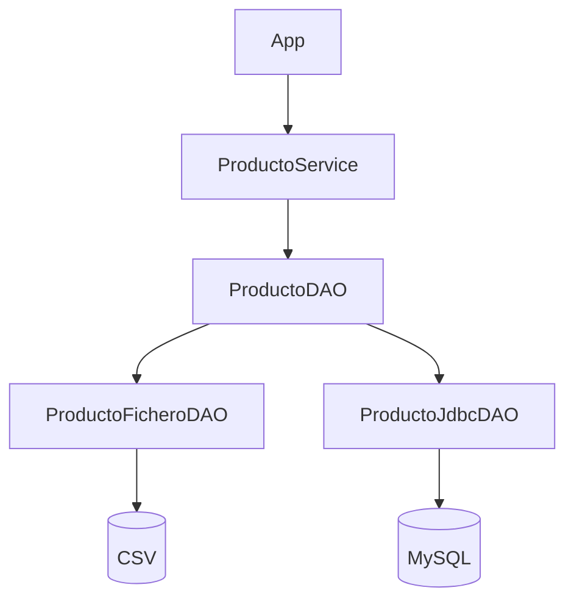

# 3.5. Componentes de acceso mediante JDBC

!!! info "Proyecto de trabajo"
    Continúa con el [proyecto inicial de Gestión de inventario](../descargas/ut3/Gestion_Inventario_Inicial_Java21_Maven.zip). Añade los archivos y las dependencias de este apartado. La solución completa se facilita al finalizar la UT3.


## Objetivos

- Sustituir el almacenamiento CSV por una implementación JDBC del mismo contrato.
- Preparar MySQL y configurar su driver en Maven.
- Comprobar que el menú y el servicio permanecen sin cambios.

## 1. La misma aplicación, otra persistencia

Ya sabemos utilizar JDBC desde UT2. Ahora el objetivo es **encapsular las sentencias SQL en un componente** que implemente `ProductoDAO`.



## 2. Crear la base de datos

Archivo: **`sql/inventario.sql`**.

```sql
CREATE DATABASE IF NOT EXISTS inventario
  CHARACTER SET utf8mb4 COLLATE utf8mb4_unicode_ci;
USE inventario;

CREATE TABLE IF NOT EXISTS producto (
    id INT PRIMARY KEY,
    nombre VARCHAR(150) NOT NULL,
    precio DOUBLE NOT NULL,
    stock INT NOT NULL
);

INSERT INTO producto (id, nombre, precio, stock)
VALUES (1, 'Teclado', 19.95, 12), (2, 'Raton', 9.50, 20)
ON DUPLICATE KEY UPDATE id = id;
```

Ejecuta el script en tu servidor MySQL. Para las prácticas se recomienda un usuario con permisos sobre la base de datos `inventario`, sin utilizar la cuenta administradora de forma habitual.

## 3. Incorporar el driver JDBC

En `pom.xml`, dentro de `<dependencies>`:

```xml
<dependency>
    <groupId>com.mysql</groupId>
    <artifactId>mysql-connector-j</artifactId>
    <version>9.2.0</version>
</dependency>
```

La versión indicada es la del proyecto de ejemplo. Si tu instalación o el repositorio de Maven requieren otra versión compatible, adapta la dependencia.

## 4. Crear el proveedor de conexiones

Archivo: **`src/main/java/es/iesisidra/inventario/util/ConexionBD.java`**.

```java
package es.iesisidra.inventario.util;

import java.sql.Connection;
import java.sql.DriverManager;
import java.sql.SQLException;

public final class ConexionBD {
    private ConexionBD() { }

    public static Connection abrir() throws SQLException {
        String url = System.getenv().getOrDefault(
                "INVENTARIO_DB_URL", "jdbc:mysql://localhost:3306/inventario");
        String usuario = System.getenv().getOrDefault("INVENTARIO_DB_USER", "inventario_app");
        String clave = System.getenv("INVENTARIO_DB_PASSWORD");
        if (clave == null) {
            throw new IllegalStateException("Falta INVENTARIO_DB_PASSWORD");
        }
        return DriverManager.getConnection(url, usuario, clave);
    }
}
```

!!! warning "Seguridad"
    No escribas contraseñas en el código ni las subas a GitHub. Utiliza variables de entorno locales. El usuario y la contraseña de MySQL deben existir previamente.

## 5. Implementar el DAO JDBC

Archivo: **`src/main/java/es/iesisidra/inventario/dao/ProductoJdbcDAO.java`**.

```java
package es.iesisidra.inventario.dao;

import es.iesisidra.inventario.modelo.Producto;
import es.iesisidra.inventario.util.ConexionBD;
import java.sql.*;
import java.util.*;

public class ProductoJdbcDAO implements ProductoDAO {
    @Override
    public void insertar(Producto p) {
        String sql = "INSERT INTO producto(id,nombre,precio,stock) VALUES(?,?,?,?)";
        try (Connection c = ConexionBD.abrir();
             PreparedStatement ps = c.prepareStatement(sql)) {
            asignar(ps, p);
            ps.executeUpdate();
        } catch (SQLException e) {
            throw new IllegalStateException("Error al insertar en MySQL", e);
        }
    }

    @Override
    public Optional<Producto> buscarPorId(int id) {
        String sql = "SELECT id,nombre,precio,stock FROM producto WHERE id=?";
        try (Connection c = ConexionBD.abrir();
             PreparedStatement ps = c.prepareStatement(sql)) {
            ps.setInt(1, id);
            try (ResultSet rs = ps.executeQuery()) {
                return rs.next() ? Optional.of(leer(rs)) : Optional.empty();
            }
        } catch (SQLException e) {
            throw new IllegalStateException("Error al buscar en MySQL", e);
        }
    }

    @Override
    public List<Producto> listar() {
        String sql = "SELECT id,nombre,precio,stock FROM producto ORDER BY id";
        try (Connection c = ConexionBD.abrir();
             PreparedStatement ps = c.prepareStatement(sql);
             ResultSet rs = ps.executeQuery()) {
            List<Producto> lista = new ArrayList<>();
            while (rs.next()) lista.add(leer(rs));
            return lista;
        } catch (SQLException e) {
            throw new IllegalStateException("Error al listar MySQL", e);
        }
    }

    @Override
    public boolean actualizar(Producto p) {
        String sql = "UPDATE producto SET nombre=?, precio=?, stock=? WHERE id=?";
        try (Connection c = ConexionBD.abrir();
             PreparedStatement ps = c.prepareStatement(sql)) {
            ps.setString(1, p.nombre());
            ps.setDouble(2, p.precio());
            ps.setInt(3, p.stock());
            ps.setInt(4, p.id());
            return ps.executeUpdate() > 0;
        } catch (SQLException e) {
            throw new IllegalStateException("Error al actualizar MySQL", e);
        }
    }

    @Override
    public boolean eliminar(int id) {
        try (Connection c = ConexionBD.abrir();
             PreparedStatement ps = c.prepareStatement("DELETE FROM producto WHERE id=?")) {
            ps.setInt(1, id);
            return ps.executeUpdate() > 0;
        } catch (SQLException e) {
            throw new IllegalStateException("Error al eliminar de MySQL", e);
        }
    }

    private static void asignar(PreparedStatement ps, Producto p) throws SQLException {
        ps.setInt(1, p.id());
        ps.setString(2, p.nombre());
        ps.setDouble(3, p.precio());
        ps.setInt(4, p.stock());
    }

    private static Producto leer(ResultSet rs) throws SQLException {
        return new Producto(rs.getInt("id"), rs.getString("nombre"),
                rs.getDouble("precio"), rs.getInt("stock"));
    }
}
```

Observa el uso de `PreparedStatement`, `try-with-resources` y un método de conversión común `leer(...)`.

## 6. Seleccionar MySQL al ejecutar

Al integrar las dos implementaciones en 3.7, la clase `App` permitirá elegir el DAO mediante la variable de entorno `INVENTARIO_STORAGE`:

- Valor `csv` (o variable ausente): `ProductoFicheroDAO`.
- Valor `mysql`: `ProductoJdbcDAO`.

Ejemplo en **PowerShell**:

```powershell
$env:INVENTARIO_STORAGE = "mysql"
$env:INVENTARIO_DB_USER = "inventario_app"
$env:INVENTARIO_DB_PASSWORD = "TU_CLAVE_LOCAL"
java -jar target/gestion-inventario-1.0-SNAPSHOT.jar
```

!!! tip "Resultado que queremos comprobar"
    El menú y el servicio son los mismos que en 3.4. Solo cambia el objeto que implementa `ProductoDAO`.

## 7. Actividades

1. Da de alta un producto desde la aplicación en modo MySQL.
2. Comprueba el resultado con `SELECT * FROM producto;`.
3. Repite las operaciones CRUD y explica qué sentencias SQL ejecuta cada método.
4. Desconecta MySQL e identifica qué error se muestra y en qué capa se origina.

**Continúa con:** [3.6. Pruebas y documentación de componentes](06-pruebas-documentacion.md).
