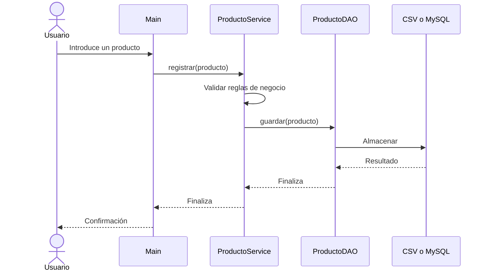

# 3.7. Integración de componentes en una aplicación

**Duración orientativa:** 2 horas · **CE i), c), d), h)**

## 1. Objetivo

Integraremos las dos implementaciones de `ProductoDAO` en **una única aplicación de consola**. La lógica de negocio y el menú permanecerán iguales; únicamente cambiará el componente de almacenamiento.

## 2. Seleccionar la implementación

```java
ProductoDAO dao;

if (modo.equalsIgnoreCase("jdbc")) {
    dao = new ProductoJdbcDAO(url, usuario, clave);
} else {
    dao = new ProductoFicheroDAO(Path.of("datos", "productos.csv"));
}

ProductoService servicio = new ProductoService(dao);
```

Este fragmento muestra el **punto de composición** de la aplicación: el lugar donde decidimos qué implementación concreta proporcionar al servicio.

## 3. El servicio no conoce el almacenamiento

```java
public class ProductoService {
    private final ProductoDAO dao;

    public ProductoService(ProductoDAO dao) {
        this.dao = dao;
    }

    public void registrar(Producto producto) throws AccesoDatosException {
        if (producto.precio() < 0) {
            throw new IllegalArgumentException("El precio no puede ser negativo");
        }
        dao.guardar(producto);
    }
}
```

En el proyecto completo se comprueban también el ID y el nombre, y se incluyen métodos de consulta y listado.

## 4. Flujo de ejecución



## 5. Integrar y comprobar

1. Ejecuta la aplicación con almacenamiento CSV.
2. Registra dos productos, búscalos y muestra el listado.
3. Reinicia la aplicación en modo JDBC (tras configurar MySQL).
4. Repite las mismas operaciones.
5. Comprueba que **no has modificado `ProductoService` ni el menú** para cambiar de almacenamiento.
6. Documenta las diferencias observadas entre ambos sistemas.

!!! info "Atención a la persistencia"
    Los productos guardados en CSV y en MySQL son **conjuntos de datos independientes**. Cambiar de implementación no migra automáticamente los registros de un sistema a otro.

## 6. Actividad final

El alumnado debe demostrar que puede sustituir una implementación de `ProductoDAO` por otra sin cambiar el código de negocio. Deberá explicar el papel de la interfaz, localizar las operaciones de persistencia y ejecutar una prueba de cada implementación.

**Evidencia CE i):** aplicación funcional, demostración de ambos modos y explicación individual de la integración.
