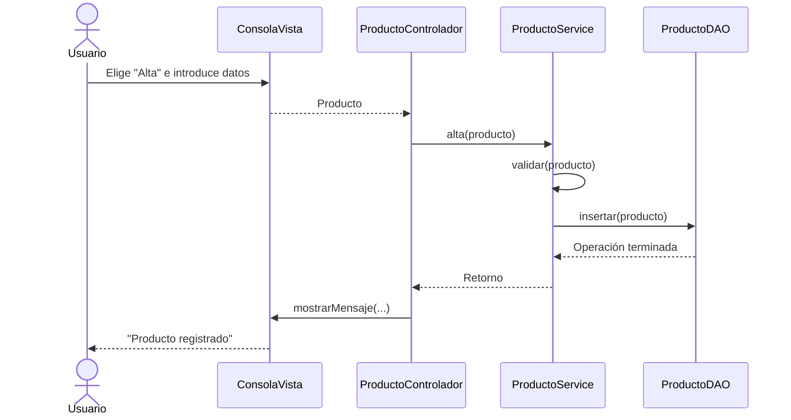

# 3.7. Integración de componentes en aplicaciones

!!! info "Proyecto de trabajo"
    Continúa con el [proyecto inicial de Gestión de inventario](../descargas/ut3/Gestion_Inventario_Inicial_Java21_Maven.zip). Añade los archivos y las dependencias de este apartado. La solución completa se facilita al finalizar la UT3.


## Objetivos

- Integrar las implementaciones CSV y JDBC en una sola aplicación.
- Elegir el mecanismo de persistencia sin modificar las reglas de negocio.
- Construir un JAR ejecutable con Maven y documentar su puesta en marcha.

## 1. Punto de integración: `App` ya no contiene el menú

En la solución inicial de la unidad, `App` reunía varias tareas. Ahora la hemos simplificado: **solo crea los objetos y los conecta**. Esta operación suele llamarse *composición* o *ensamblaje de dependencias*.

La clase `Configuracion` decide qué implementación de `ProductoDAO` utilizar según la variable de entorno `INVENTARIO_STORAGE`.

Archivo: `src/main/java/es/iesisidra/inventario/configuracion/Configuracion.java`.

```java
public static ProductoDAO crearDao() {
    String modo = System.getenv()
            .getOrDefault("INVENTARIO_STORAGE", "csv")
            .trim()
            .toLowerCase(Locale.ROOT);

    return switch (modo) {
        case "csv" -> new ProductoFicheroDAO(Path.of("datos", "productos.csv"));
        case "mysql" -> new ProductoJdbcDAO();
        default -> throw new IllegalArgumentException(
                "INVENTARIO_STORAGE debe ser csv o mysql: " + modo);
    };
}
```

Este fragmento pertenece a la clase `Configuracion` e incorpora las importaciones de `ProductoDAO`, sus implementaciones, `Path` y `Locale`.

La clase `App` utiliza el DAO seleccionado para crear el servicio, después crea la vista y finalmente arranca el controlador:

```java
ProductoDAO dao = Configuracion.crearDao();
ProductoService servicio = new ProductoService(dao);

try (Scanner scanner = new Scanner(System.in)) {
    ConsolaVista vista = new ConsolaVista(scanner, System.out);
    new ProductoControlador(servicio, vista).iniciar();
}
```

### ¿Qué ocurre cuando el usuario elige una opción?



La vista **no conoce** la base de datos; el servicio **no conoce** el menú; el controlador **no conoce** los detalles de CSV o JDBC.

!!! important "Concepto clave"
    `ProductoService` depende de la interfaz `ProductoDAO`. Cambiar la variable de entorno solo modifica qué implementación se construye al arrancar. No requiere cambios en `ConsolaVista`, `ProductoControlador` ni `ProductoService`.

## 2. Preparar el JAR ejecutable

Para distribuir el proyecto necesitamos un JAR que contenga la aplicación y, cuando utilicemos MySQL, también las dependencias necesarias.

Un JAR creado únicamente con `maven-jar-plugin` **no incluye automáticamente** el driver JDBC. Por eso la solución final utiliza `maven-shade-plugin`: construye un JAR con dependencias e incorpora la clase principal al manifiesto.

En el `pom.xml`, dentro de `<build><plugins>`, se configura:

```xml
<plugin>
    <groupId>org.apache.maven.plugins</groupId>
    <artifactId>maven-shade-plugin</artifactId>
    <version>3.6.0</version>
    <executions>
        <execution>
            <phase>package</phase>
            <goals>
                <goal>shade</goal>
            </goals>
            <configuration>
                <createDependencyReducedPom>false</createDependencyReducedPom>
                <transformers>
                    <transformer implementation="org.apache.maven.plugins.shade.resource.ManifestResourceTransformer">
                        <mainClass>es.iesisidra.inventario.App</mainClass>
                    </transformer>
                </transformers>
            </configuration>
        </execution>
    </executions>
</plugin>
```

**Lectura guiada del XML:**

- `phase=package`: el plugin actúa al empaquetar.
- `goal=shade`: construye el artefacto con las dependencias.
- `ManifestResourceTransformer`: incorpora al manifiesto la clase que inicia la aplicación.
- `mainClass`: señala `es.iesisidra.inventario.App`, aunque esa clase ya no contiene el menú.

No es necesario memorizar el XML: comprende **qué problema resuelve** cada parte.

## 3. Construcción final

```bash
mvn clean package
```

Resultado esperado:

```text
target/gestion-inventario-1.0-SNAPSHOT.jar
```

La solución de referencia incorpora `maven-shade-plugin` en su `pom.xml`. Si estás construyendo el proyecto desde la plantilla inicial, debes añadir esa configuración antes de ejecutar el JAR con `java -jar`.

## 4. Ejecutar con CSV

Por defecto:

```bash
java -jar target/gestion-inventario-1.0-SNAPSHOT.jar
```

El fichero se guarda en `datos/productos.csv`, relativo al directorio desde el que ejecutamos el programa.

## 5. Ejecutar con MySQL

Primero ejecuta `sql/inventario.sql` en MySQL y configura las variables de entorno.

**PowerShell:**

```powershell
$env:INVENTARIO_STORAGE = "mysql"
$env:INVENTARIO_DB_URL = "jdbc:mysql://localhost:3306/inventario"
$env:INVENTARIO_DB_USER = "inventario_app"
$env:INVENTARIO_DB_PASSWORD = "TU_CLAVE_LOCAL"
java -jar target/gestion-inventario-1.0-SNAPSHOT.jar
```

**Linux (bash):**

```bash
export INVENTARIO_STORAGE=mysql
export INVENTARIO_DB_URL=jdbc:mysql://localhost:3306/inventario
export INVENTARIO_DB_USER=inventario_app
export INVENTARIO_DB_PASSWORD='TU_CLAVE_LOCAL'
java -jar target/gestion-inventario-1.0-SNAPSHOT.jar
```

No compartas las contraseñas ni las guardes en el repositorio.

## 6. Comprobar la integración

Realiza estas operaciones en **ambos modos**:

1. Listar productos.
2. Insertar un producto nuevo.
3. Buscar el producto por su identificador.
4. Modificar el precio y el stock.
5. Eliminarlo.

Anota si el menú cambia y qué componente es responsable de la persistencia. Identifica además los métodos del controlador que se ejecutan en cada operación.

## 7. Propuesta de ampliación

Añade una tercera implementación `ProductoMemoriaDAO` y comprueba que no necesitas modificar ni `ConsolaVista`, ni `ProductoControlador`, ni `ProductoService`. Solo tendrás que adaptar la composición de dependencias en `Configuracion`.

Como reto adicional, puedes sustituir el CSV simplificado por una biblioteca que gestione correctamente campos entrecomillados y separadores.

## 8. Entrega del proyecto

Entrega:

- Repositorio Git con historial de desarrollo.
- Proyecto Maven completo y compilable con Java 21.
- Implementaciones CSV y JDBC de `ProductoDAO`.
- Script SQL y datos de ejemplo.
- Pruebas unitarias ejecutables mediante `mvn test`.
- Breve README con instrucciones para ejecutar ambas versiones.

**Continúa con:** [Ejercicios, proyecto y descargas](08-actividades-descargas.md).
