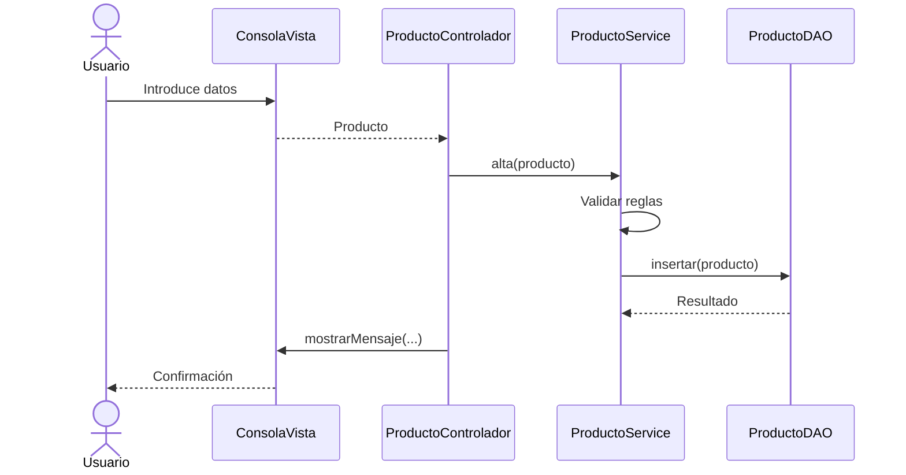

# 3.7. Integración de componentes en aplicaciones

!!! info "Proyecto de trabajo"
    Continúa con el [proyecto inicial de Gestión de inventario](../descargas/ut3/Gestion_Inventario_Inicial_Java21_Maven.zip). Añade los archivos y las dependencias de este apartado. La solución completa se facilita al finalizar la UT3.


## Objetivos

- Integrar las implementaciones CSV y JDBC en una sola aplicación.
- Elegir el mecanismo de persistencia sin modificar las reglas de negocio.
- Construir un JAR ejecutable con Maven y documentar su puesta en marcha.

## 1. Integrar las capas: composición en `App`

Hasta ahora hemos construido componentes con responsabilidades diferentes. **La aplicación no debe decidir cómo se conecta a MySQL dentro del menú**: la configuración se lee una vez al arrancar y una fábrica construye el DAO correspondiente.

### 1.1. Fichero de configuración externo

El proyecto incorpora `config/configuracion.properties.example`. Haz una copia con el nombre `config/configuracion.properties`, dentro del proyecto:

```properties
# CSV (modo inicial)
almacenamiento.tipo=csv
csv.ruta=datos/productos.csv

# Solo se utilizan cuando seleccionamos MySQL
db.url=jdbc:mysql://localhost:3306/inventario
db.usuario=inventario_app
db.password=
```

Para cambiar a MySQL, cambia `almacenamiento.tipo=mysql`, completa el usuario y la contraseña y ejecuta antes `sql/inventario.sql`. **No es necesario introducir variables de entorno en PowerShell o Bash.**

!!! warning "Contraseñas y repositorios"
    `config/configuracion.properties` contiene información local y se excluye mediante `.gitignore`. Comparte únicamente `configuracion.properties.example`, sin contraseñas reales. El fichero se busca respecto al **directorio de trabajo**, que debe ser la raíz del proyecto.

### 1.2. `Configuracion`: lectura con `Properties` y try-with-resources

La clase `configuracion/Configuracion.java` encapsula la lectura y la consulta de propiedades. No crea conexiones ni imprime menús.

```java
Path ruta = Path.of("config", "configuracion.properties");
Properties propiedades = new Properties();
try (InputStream entrada = Files.newInputStream(ruta)) {
    propiedades.load(entrada);
} catch (IOException e) {
    throw new IllegalStateException("No se puede leer la configuración", e);
}
```

El `try-with-resources` cierra el flujo incluso si se produce una excepción. El código completo comprueba además que el fichero existe y que las propiedades obligatorias tienen valor.

### 1.3. `FabricaDao`: decidir CSV o MySQL

La clase `configuracion/FabricaDao.java` interpreta `almacenamiento.tipo` y crea la implementación correspondiente. Es el único lugar donde se elige entre `ProductoFicheroDAO` y `ProductoJdbcDAO`.

```java
return switch (config.obtener("almacenamiento.tipo", "csv")) {
    case "csv" -> new ProductoFicheroDAO(Path.of(config.obligatorio("csv.ruta")));
    case "mysql" -> new ProductoJdbcDAO(new ConexionBD(
            config.obligatorio("db.url"),
            config.obligatorio("db.usuario"),
            config.obligatorio("db.password")));
    default -> throw new IllegalArgumentException("Modo de almacenamiento no válido");
};
```

Este fragmento resume la decisión. La implementación completa también normaliza las mayúsculas/minúsculas del modo.

### 1.4. `App`: punto de entrada mínimo

La clase `App` **no contiene el menú, las operaciones CRUD, sentencias SQL ni lectura de propiedades**. Solo conecta los objetos:

```java
Configuracion configuracion = Configuracion.cargar();
ProductoService servicio = new ProductoService(FabricaDao.crear(configuracion));

try (Scanner teclado = new Scanner(System.in)) {
    ConsolaVista vista = new ConsolaVista(teclado, System.out);
    new ProductoControlador(vista, servicio).iniciar();
}
```

El código mostrado es el núcleo del método `main`; consulta la clase completa en el ZIP de la solución.

### 1.5. Recorrido de una operación



**Observa:** la vista no accede al DAO, el servicio no lee del teclado y el DAO no decide cómo presentar mensajes.

## 2. Preparar el JAR ejecutable

Para distribuir el proyecto necesitamos un JAR que contenga la aplicación y, cuando utilicemos MySQL, también las dependencias necesarias.

Un JAR creado únicamente con `maven-jar-plugin` **no incluye automáticamente** el driver JDBC. Por eso la solución final utiliza `maven-shade-plugin`: construye un JAR con dependencias e incorpora la clase principal al manifiesto.

En el `pom.xml`, dentro de `<build><plugins>`, se configura:

```xml
<plugin>
    <groupId>org.apache.maven.plugins</groupId>
    <artifactId>maven-shade-plugin</artifactId>
    <version>3.6.0</version>
    <executions>
        <execution>
            <phase>package</phase>
            <goals>
                <goal>shade</goal>
            </goals>
            <configuration>
                <createDependencyReducedPom>false</createDependencyReducedPom>
                <transformers>
                    <transformer implementation="org.apache.maven.plugins.shade.resource.ManifestResourceTransformer">
                        <mainClass>es.iesisidra.inventario.App</mainClass>
                    </transformer>
                </transformers>
            </configuration>
        </execution>
    </executions>
</plugin>
```

**Lectura guiada del XML:**

- `phase=package`: el plugin actúa al empaquetar.
- `goal=shade`: construye el artefacto con las dependencias.
- `ManifestResourceTransformer`: incorpora al manifiesto la clase que inicia la aplicación.
- `mainClass`: señala `es.iesisidra.inventario.App`, aunque esa clase ya no contiene el menú.

No es necesario memorizar el XML: comprende **qué problema resuelve** cada parte.

## 3. Construcción final

```bash
mvn clean package
```

Resultado esperado:

```text
target/gestion-inventario-1.0-SNAPSHOT.jar
```

La solución de referencia incorpora `maven-shade-plugin` en su `pom.xml`. Si estás construyendo el proyecto desde la plantilla inicial, debes añadir esa configuración antes de ejecutar el JAR con `java -jar`.

## 4. Ejecutar con CSV

En `config/configuracion.properties` establece:

```properties
almacenamiento.tipo=csv
csv.ruta=datos/productos.csv
```

Desde la **raíz del proyecto**:

```bash
mvn clean package
java -jar target/gestion-inventario-1.0-SNAPSHOT.jar
```

El fichero CSV se leerá y guardará en `datos/productos.csv`.

## 5. Ejecutar con MySQL

1. Inicia MySQL y ejecuta `sql/inventario.sql`.
2. Crea o utiliza un usuario con permisos sobre la base de datos.
3. Modifica `config/configuracion.properties`:

```properties
almacenamiento.tipo=mysql
db.url=jdbc:mysql://localhost:3306/inventario
db.usuario=inventario_app
db.password=TU_CONTRASENA_LOCAL
```

4. Ejecuta `java -jar target/gestion-inventario-1.0-SNAPSHOT.jar` desde la raíz.

**No hay que definir variables de entorno.** Para volver a CSV, cambia únicamente `almacenamiento.tipo=csv`.

## 6. Comprobar la integración

Realiza estas operaciones en **ambos modos**:

1. Listar productos.
2. Insertar un producto nuevo.
3. Buscar el producto por su identificador.
4. Modificar el precio y el stock.
5. Eliminarlo.

Anota si el menú cambia y qué componente es responsable de la persistencia. Identifica además los métodos del controlador que se ejecutan en cada operación.

## 7. Propuesta de ampliación

Añade una tercera implementación `ProductoMemoriaDAO` y comprueba que no necesitas modificar ni `ConsolaVista`, ni `ProductoControlador`, ni `ProductoService`. Solo tendrás que adaptar la composición de dependencias en `Configuracion`.

Como reto adicional, puedes sustituir el CSV simplificado por una biblioteca que gestione correctamente campos entrecomillados y separadores.

## 8. Entrega del proyecto

Entrega:

- Repositorio Git con historial de desarrollo.
- Proyecto Maven completo y compilable con Java 21.
- Implementaciones CSV y JDBC de `ProductoDAO`.
- Script SQL y datos de ejemplo.
- Pruebas unitarias ejecutables mediante `mvn test`.
- Breve README con instrucciones para ejecutar ambas versiones.

**Continúa con:** [Ejercicios, proyecto y descargas](08-actividades-descargas.md).
