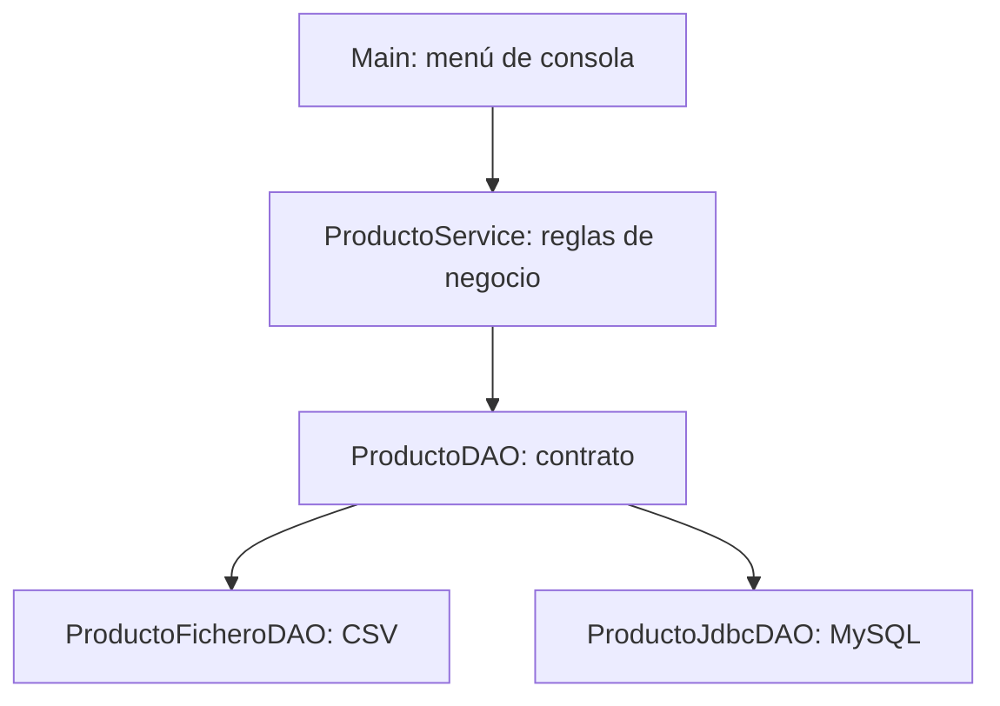

# UT3. Diseño y desarrollo de componentes de acceso a datos

!!! info "Guía didáctica · Acceso a Datos · 2.º DAM"
    **Duración:** 20 horas · **Resultado de aprendizaje:** RA6 (parcial) · **Criterios:** a), b), c), d), h), i).

## ¿Qué aprenderemos?

En la UT1 escribimos programas que leen y guardan información en **ficheros**. En la UT2 conectamos programas Java con **bases de datos relacionales mediante JDBC**. En esta unidad damos un paso más: diseñamos **componentes de acceso a datos reutilizables** que otras aplicaciones puedan utilizar sin conocer cómo se almacenan los datos.

El reto será crear una aplicación de **gestión de productos** capaz de utilizar indistintamente un fichero CSV o una base de datos MySQL.

## Resultado de aprendizaje

**RA6.** Programa componentes de acceso a datos identificando las características que debe poseer un componente y utilizando herramientas de desarrollo.

| CE | Qué debes demostrar en esta unidad | Evidencia propuesta |
|---|---|---|
| **a)** | Valorar ventajas e inconvenientes de la programación orientada a componentes. | Análisis de diseños y cuestiones razonadas. |
| **b)** | Identificar herramientas de desarrollo de componentes. | Proyecto Maven, IDE, compilación y empaquetado. |
| **c)** | Programar componentes que gestionen datos en ficheros. | `ProductoFicheroDAO`. |
| **d)** | Programar componentes que gestionen datos mediante conectores. | `ProductoJdbcDAO`. |
| **h)** | Probar y documentar componentes. | Pruebas, Javadoc y README. |
| **i)** | Integrar los componentes en aplicaciones. | Aplicación de consola que cambia de implementación. |

Los criterios **e)**, **f)** y **g)** del RA6 se desarrollarán en las UT4, UT6 y UT5, respectivamente. **Hibernate no se estudia en esta unidad.**

## Itinerario y temporalización

| Página | Horas | CE principales |
|---|---:|---|
| [3.1. Componentes software](01-componentes.md) | 2 | a) |
| [3.2. Herramientas de desarrollo](02-herramientas.md) | 2 | b) |
| [3.3. Arquitectura, interfaces y DAO](03-arquitectura-dao.md) | 4 | a), c), d), i) |
| [3.4. DAO de ficheros CSV](04-componentes-ficheros.md) | 3 | c), h) |
| [3.5. DAO JDBC](05-componentes-jdbc.md) | 4 | d), i) |
| [3.6. Pruebas y documentación](06-pruebas-documentacion.md) | 3 | h) |
| [3.7. Integración](07-integracion.md) | 2 | i), c), d), h) |
| **Total** | **20** | |

## Arquitectura del proyecto

La aplicación dependerá de la **interfaz `ProductoDAO`**, no de una implementación concreta. La elección entre CSV y MySQL se realizará al iniciar el programa.

## Herramientas

- **JDK 21**, **Maven** y un IDE (VS Code, Eclipse o IntelliJ IDEA).
- **JUnit 5** para pruebas automatizadas.
- **MySQL** y su conector JDBC para la implementación relacional.
- Git para conservar el historial del proyecto.

## Evaluación

La programación didáctica establece **práctica(s): 60 %** y **prueba objetiva: 40 %**. En la comprobación individual de las prácticas, por cada CE práctico se valoran la ejecución correcta (hasta **6 puntos**) y la comprensión/explicación de lo realizado (hasta **4 puntos**).

!!! warning "Autoría y comprensión"
    Debes poder explicar tus decisiones, ejecutar el proyecto y reproducir o modificar partes de tu código durante la revisión. La entrega de código que funciona no garantiza por sí sola la máxima calificación.

Consulta los [ejercicios, proyecto integrador y descargas](08-actividades-descargas.md).
