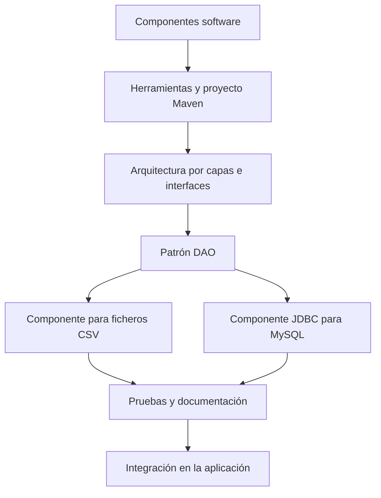

# UT3 · Diseño y desarrollo de componentes de acceso a datos

En la UT1 aprendimos a gestionar información almacenada en **ficheros** y en la UT2 a acceder a **bases de datos relacionales mediante JDBC**. En esta unidad aprenderás a diseñar y desarrollar **componentes de acceso a datos reutilizables**, separando las responsabilidades de una aplicación para facilitar su mantenimiento, las pruebas y la integración.

Como proyecto conductor utilizaremos una aplicación de **gestión de productos** que podrá almacenar información en un fichero CSV o en una base de datos MySQL mediante distintas implementaciones de una misma interfaz.

## Contenidos

1. **[Programación orientada a componentes](01-componentes.md).** Concepto de componente, características, ventajas e inconvenientes.
2. **[Herramientas de desarrollo](02-herramientas.md).** IDE, JDK 21, conceptos esenciales de Maven, paquetes y visibilidad.
3. **[Arquitectura por capas, interfaces y DAO](03-arquitectura-dao.md).** Separación de responsabilidades, cohesión, acoplamiento, interfaces, polimorfismo y patrón DAO.
4. **[Componentes de acceso a ficheros](04-componentes-ficheros.md).** Encapsulación de operaciones de lectura y escritura en ficheros CSV.
5. **[Componentes de acceso mediante JDBC](05-componentes-jdbc.md).** Desarrollo de componentes que gestionan información almacenada en bases de datos MySQL mediante conectores.
6. **[Pruebas y documentación](06-pruebas-documentacion.md).** Pruebas de componentes, JUnit 5, Javadoc y documentación de uso.
7. **[Integración de componentes](07-integracion.md).** Utilización de componentes desde una aplicación y sustitución de implementaciones.

Para ampliar la configuración y el uso de Maven, consulta el **[Anexo · Apache Maven para proyectos Java](../anexo_maven.md)**.

## Resultado de aprendizaje

**RA6.** Programa componentes de acceso a datos identificando las características que debe poseer un componente y utilizando herramientas de desarrollo.

En esta unidad se trabajan los criterios **a), b), c), d), h) e i)** del RA6. Los restantes criterios se desarrollarán en otras unidades del módulo.

## Criterios de evaluación

| CE | Criterio de evaluación |
|---|---|
| **a)** | Se han valorado las ventajas e inconvenientes de utilizar programación orientada a componentes. |
| **b)** | Se han identificado herramientas de desarrollo de componentes. |
| **c)** | Se han programado componentes que gestionan información almacenada en ficheros. |
| **d)** | Se han programado componentes que gestionan mediante conectores información almacenada en bases de datos. |
| **h)** | Se han probado y documentado los componentes desarrollados. |
| **i)** | Se han integrado los componentes desarrollados en aplicaciones. |

## Evaluación y calificación de la UT3

La unidad desarrolla una parte del **RA6**, que tiene una ponderación del **15 % en la calificación final del módulo**.

Para evaluar los criterios de evaluación asociados a esta unidad se utilizarán los siguientes instrumentos:

| Instrumento | Peso |
|---|---:|
| **PEC (prácticas evaluables)** | **60 %** |
| **Prueba objetiva** | **40 %** |

### 1. PEC: prácticas evaluables (60 %)

Las actividades prácticas permitirán trabajar el diseño de componentes, el acceso a ficheros y bases de datos, la realización de pruebas y la integración en una aplicación.

Los enunciados concretos, las condiciones de entrega y los plazos se comunicarán a través del **aula virtual**. Esta guía no establece un número cerrado de entregas ni una ponderación independiente para cada ejercicio.

Las prácticas deberán ser **originales y realizadas por el propio alumno o alumna**.

Podrán calificarse mediante observación directa registrada en una ficha de seguimiento y/o mediante rúbrica, según las características de la actividad.

#### ¿Cómo se califica cada criterio de evaluación práctico?

| Evidencia | Qué se comprobará | Puntuación máxima |
|---|---|---:|
| **Ejecución correcta** | Desarrolla y demuestra los componentes y procedimientos solicitados. | **6 puntos** |
| **Comprensión y explicación** | Explica el funcionamiento del código, las decisiones de diseño y la integración de los componentes. | **4 puntos** |
| **Total por CE práctico** | | **10 puntos** |

Durante la revisión, la profesora podrá solicitar que el estudiante:

- Ejecute el proyecto y demuestre su funcionamiento.
- Explique las clases, interfaces y métodos desarrollados.
- Justifique las decisiones de diseño adoptadas.
- Interprete el funcionamiento de su código.
- Reproduzca o modifique alguno de los procedimientos realizados.

Estas comprobaciones permitirán verificar tanto la **autoría del trabajo** como la **comprensión de los contenidos**.

**Importante:** la correcta entrega o ejecución de una práctica no garantiza la puntuación máxima. También será necesario demostrar que se comprenden los procedimientos realizados.

!!! warning "Autoría de las prácticas"
    Las prácticas deben ser **originales y de elaboración propia**. Si se acredita copia, presentación como propio de un trabajo no realizado o utilización de medios no autorizados, **la práctica se calificará con 0**, conforme a la guía didáctica.

### 2. Prueba objetiva (40 %)

La prueba objetiva incluirá contenidos teórico-prácticos de la unidad y podrá combinar diferentes tipos de preguntas y ejercicios:

- Preguntas de tipo test.
- Preguntas cortas o de desarrollo.
- Cuestiones abiertas o cerradas.
- Ejercicios prácticos de programación.
- Análisis, interpretación o corrección de fragmentos de código Java.

Estos son formatos posibles y no implican una distribución fija de preguntas ni de puntuaciones dentro del examen.

## Mapa de la unidad

## Materiales didácticos

Los apuntes, ejemplos y recursos necesarios para esta unidad se encuentran disponibles en:

- **Aula virtual del módulo de Acceso a Datos.**
- **[Sitio web de Acceso a Datos – UT3](https://rlrprofe.github.io/AD-2627/ut3/).**
- **[Ejercicios, proyecto y descargas](08-actividades-descargas.md).**

Para realizar las prácticas se utilizarán **JDK 21**, **Maven**, un entorno de desarrollo Java, **MySQL** y, cuando corresponda, **JUnit 5**.

Se propone una batería de ejercicios para practicar los contenidos de la unidad.

**Es imprescindible que el alumnado realice los ejercicios propuestos y plantee sus dudas durante las clases.**

## Cómo utilizar estos materiales

Cada bloque contiene explicaciones, ejemplos progresivos y actividades prácticas. Los ejemplos Java están planteados para **JDK 21**.

Se recomienda estudiar primero los conceptos de cada apartado, ejecutar los ejemplos proporcionados y realizar posteriormente los ejercicios de forma autónoma.

El repaso de **interfaces y polimorfismo** del apartado 3.3 es especialmente importante para comprender el patrón DAO y la sustitución de componentes.
